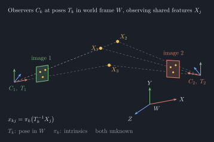
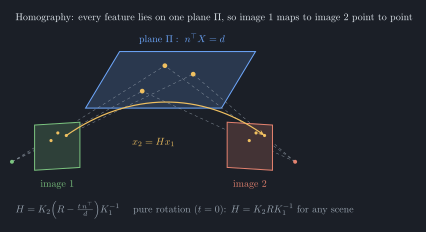
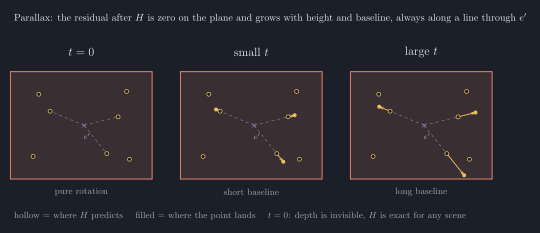
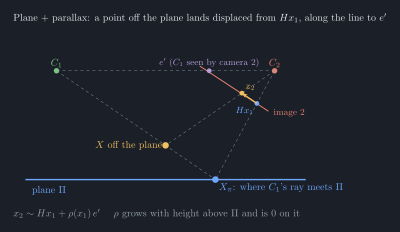
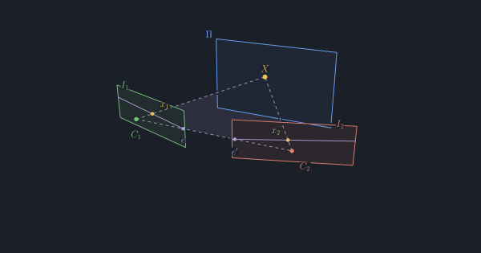
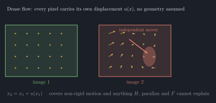
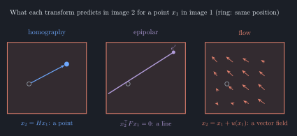

# Two cameras as equivalent evidence on one canvas

## World

Observers (cameras) sit at unknown poses $T_k$ in a world frame $W$ and observe features $X_j$ with unknown intrinsics $\pi_k$:

$$x_{kj} = \pi_k\!\left(T_k^{-1} X_j\right)$$

The two cameras are the same kind of observer. They differ only in $T_k$ and $\pi_k$.

## Model

One shared hidden canvas $h$. Each camera $k$ has its own learned readout:

$$\hat{x}_k = g_k(h), \qquad e_k = x_k - \hat{x}_k$$

The canvas is corrected by the errors of every enabled camera at once. Cameras differ only through $g_k$ (pose and intrinsics are absorbed into it). No geometry is assumed.

## Phase 1 (multi-device agent)

- A second readout branch for camera 2 over the same canvas.
- Cover camera 1 and camera 2 still corrects the canvas.
- No coupling between branches; no homography.

## Phase 2: visualize correspondences

No transform is fitted for now. Once both cameras project onto the canvas, the correspondence should show itself there. Phase 2 only makes it visible:

1. Show each camera's prediction $g_k(h)$ and error $e_k$ next to the canvas.
2. Show the underlying mappings: for a selected hidden unit $i$, its receptive field in each camera (from $g_k$).
3. Show which canvas regions both cameras excite.

Fitting a transform to the receptive-field centroids $c_i^{(k)}$ is deferred until the visualization shows which description fits (next section).

## Candidate transforms

Later, the correspondences can be compared against several transforms. They form a chain of generalizations, so a fit that fails at one level shows what the next level adds.

### Homography $H$

Point to point. Exact for a plane or a pure rotation. Residual structure that grows with scene depth means $\rho\neq 0$.

### Plane + parallax

**Parallax** is the apparent shift of a point between two views caused by the camera moving. Near points shift a lot, far points barely at all: the shift is proportional to translation and inversely proportional to depth.

Pick a dominant plane (floor, wall) and fit $H$ to it. Points on the plane land exactly where $H$ predicts. Every other point lands off by a residual:

$x_2\sim Hx_1+\rho(x_1)\,e'$

- The residual always points along the line through the epipole $e'$, so the unknown per pixel is one number $\rho$ (height over depth), not a 2D flow vector.
- $\rho$ is zero on the plane and grows with height off the plane and with baseline.
- $e'$ gives the direction of translation. $\rho$ gives relative depth.

What it enables that $H$ alone misses:

- $H$ treats the whole scene as one plane, so it has no opinion about anything off it. Parallax turns that failure into a depth measurement.
- Dense structure from two views without calibration: depth is read from how far each point is off $H$.
- Separating the plane from clutter: points with $\rho\approx 0$ are on the plane, the rest are not.

The two limits, shown below left to right ($t$ is the translation between the cameras):

- $t=0$ (pure rotation): the residual is zero for every point, so $H$ is exact for any scene. Depth is unobservable.
- $t$ large: $H$ explains only the plane. The residual carries the scene's structure, and the more translation, the stronger the depth signal.

### Fundamental $F$ and essential $E$

Point to line. Holds for any rigid scene without needing depth; $E$ adds known intrinsics.

### Dense flow $u(x)$

No geometry assumed. Covers non-rigid motion and anything the others miss.

### Side by side

## Open questions

- A homography is exact only for planar or distant scenes. Which level of the chain is the first that fits the measured correspondences?
- EO and IR are not a matched pair. Do shared units emerge at all without cross-modal supervision?
- Should the checkerboard calibration be an independent baseline?
- Where does the visualization show up in the TUI: tile, overlay or log?
