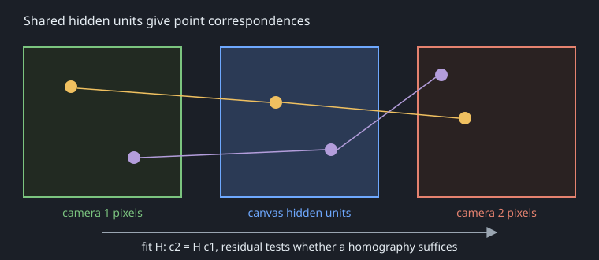
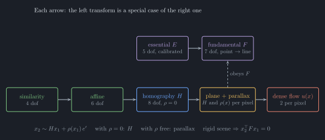

<script setup>
import { ref, computed } from "vue";
import SceneFigure from "./SceneFigure.vue";
import TransformProgression from "./TransformProgression.vue";
import { DEFAULTS, READER_LIMITS, createWorld, readerView } from "./scene.mjs";
const baseline = ref(DEFAULTS.baseline);
const height = ref(DEFAULTS.height);
const azimuth = ref(DEFAULTS.azimuth);
const elevation = ref(DEFAULTS.elevation);
const world = computed(() => createWorld({ baseline: baseline.value, height: height.value }));
const reader = computed(() => readerView({ azimuth: azimuth.value, elevation: elevation.value }));
function orbit(view) {
  azimuth.value = view.azimuth;
  elevation.value = view.elevation;
}
function resetView() {
  orbit(DEFAULTS);
}
</script>

# Two cameras as equivalent evidence on one canvas

## World

Observers (cameras) sit at unknown poses $T_k$ in a world frame $W$ and observe features $X_j$ with unknown intrinsics $\pi_k$:

$$x_{kj} = \pi_k\!\left(T_k^{-1} X_j\right)$$

$x_{kj}$ is feature $j$'s image position in camera $k$; $\pi_k$ projects a point from that camera's coordinates into its image.

The main figures share one synthetic 3D scene. Their camera parameters are known for illustration; they are not estimates from the learned canvas. The reader is a third perspective observer: changing your viewpoint changes the drawing, not the cameras' observations.

Mouse or pen drag rotates any 3D figure through a full orbit. All 3D views share that viewpoint; **Reset view** restores the static framing. On touch screens, the figures remain horizontally pannable and the sliders rotate the view.

<div class="scene-controls">
  <label for="reader-azimuth">reader azimuth</label><input id="reader-azimuth" type="range" :min="-READER_LIMITS.azimuth" :max="READER_LIMITS.azimuth" step="1" v-model.number="azimuth" /><output for="reader-azimuth">{{ azimuth }}°</output>
  <label for="reader-elevation">reader elevation</label><input id="reader-elevation" type="range" :min="-READER_LIMITS.elevation" :max="READER_LIMITS.elevation" step="1" v-model.number="elevation" /><output for="reader-elevation">{{ elevation }}°</output>
</div>

<SceneFigure mode="world" :world="world" :reader="reader" @orbit="orbit" @reset-view="resetView" />

**In the figure:** $W$ marks the world origin. $C_k$ is a camera's projection centre; $I_k$ its virtual image plane (green or coral); $O_k$ its image-coordinate origin, where the optical axis meets that plane. $X$ is a test feature and $x_k$ its ray's intersection with $I_k$. $\Pi$ is the blue reference plane. Camera centres are not image origins.

The virtual surfaces are transparent. At projected edge/ray crossings, the farther stroke has a small gap to show depth. Only labelled dots mark the actual ray/plane intersections.

The two cameras are the same kind of observer. They differ only in $T_k$ and $\pi_k$.

## Model

One shared hidden canvas $h$. Each camera $k$ has its own learned readout:

$$\hat{x}_k = g_k(h), \qquad e_k = x_k - \hat{x}_k$$

$x_k$ is camera $k$'s observed image, $\hat{x}_k$ its prediction, and $e_k$ their difference. The learned map $g_k$ produces an image from canvas state $h$.

The canvas is corrected by the errors of every enabled camera at once. Cameras differ only through $g_k$ (pose and intrinsics are absorbed into it). No geometry is assumed.

## Phase 1 (multi-device agent)

- A second readout branch for camera 2 over the same canvas.
- Cover camera 1 and camera 2 still corrects the canvas.
- No coupling between branches; no homography.

## Phase 2: visualize correspondences

No transform is fitted for now. Once both cameras project onto the canvas, the correspondence should show itself there. Phase 2 only makes it visible:

Here $h$ is the shared canvas state, $g_k$ camera $k$'s learned readout, and $e_k$ its image prediction error. A shared unit $i$ has a receptive-field centre $c_i^{(k)}$ in each camera's image.

1. Show each camera's prediction $g_k(h)$ and error $e_k$ next to the canvas.
2. Show the underlying mappings: for a selected hidden unit $i$, its receptive field in each camera (from $g_k$).
3. Show which canvas regions both cameras excite.

Fitting a transform to the receptive-field centroids $c_i^{(k)}$ is deferred until the visualization shows which description fits (next section).



## Candidate transforms

Later, the correspondences can be compared against several transforms. The solid arrows show increasingly flexible descriptions of matches. Calibration converts $E$ and $F$ between coordinate systems; that link is not a special-case relation.



**Symbols:** $H$ is a plane's image mapping; $E,F$ constrain matches to epipolar lines; $\rho$ is scalar parallax along epipole $e'$; $u(x)$ is a displacement at image position $x$.

### From similarity to plane + parallax

Uniform scale, rotation and translation form a **similarity**. Unequal scale or shear needs an **affine** map. A **homography** adds a perspective divide, so parallel lines can converge. These three families of 2D mappings are nested; plane-plus-parallax adds depth:

| Model | Mapping | What it preserves |
|---|---|---|
| Similarity · 4 degrees of freedom | $x_2=sR_{\mathrm{2D}}x_1+t_{\mathrm{2D}}$ | Angles and length ratios |
| Affine · 6 degrees of freedom | $x_2=Ax_1+t_{\mathrm{2D}}$ | Straight lines and parallelism |
| Homography · 8 degrees of freedom | $\widetilde x_2\sim H\widetilde x_1$ | Straight lines, not necessarily parallelism |
| Plane + parallax | $\widetilde x_2\sim H\widetilde x_1+\rho e'$ | A rigid scene's epipolar constraint |

Here $s$ is a uniform scale, $R_{\mathrm{2D}}$ a planar rotation, $t_{\mathrm{2D}}$ a 2D translation, and $A$ an invertible $2\times2$ matrix. $\widetilde x=[x^\top,1]^\top$ lifts an image position into homogeneous coordinates; $\sim$ means equality up to scale. Uniform scale alone stays within similarity. Plane-plus-parallax is a description of 3D structure under camera translation, not another single 2D matrix.

Move either slider continuously or select a milestone. The experiment first zooms and rolls camera 2, then tilts the reference plane, then turns camera 2, and finally lifts interior samples off the plane. Each stage retains the earlier changes.

#### Image matches (2D)

<TransformProgression :reader="reader" />

The image-1 grid defines fixed viewing rays. Their intersections with $\Pi$ construct the plane samples in 3D; the final stage moves interior samples toward camera 1 along those rays. Parallel optical axes at equal camera depth give an exact affine mapping of the tilted plane.

#### Scene construction (3D)

This view has its own progression slider. At matching slider values, the 2D and 3D views use identical points and pinhole cameras.

<TransformProgression view="3d" :reader="reader" @orbit="orbit" @reset-view="resetView" />

The experiment has its own controlled geometry and fixed framing; its reader orientation is shared with the main scene. The baseline and off-plane controls below still belong to the main scene. Parallax needs camera translation and off-plane structure; it vanishes for a plane or coincident camera centres.

### Homography $H$

The homography $H$ maps reference-plane points between images. Under pure rotation, it is exact at every depth.

<SceneFigure mode="homography" :world="world" :reader="reader" @orbit="orbit" @reset-view="resetView" />

**Symbols:** $C_1,C_2$ are projection centres. $X_\pi$ is where $C_1$'s ray through test feature $X$ meets reference plane $\Pi$; its image positions are $x_1$ in camera 1 and blue $Hx_1$ in camera 2. $K_1,K_2$ are intrinsics. With relative pose $X_{c2}=R X_{c1}+t$ and plane $n^\top X_{c1}=d$, the mapping is

$$H=K_2\left(R+\frac{t n^\top}{d}\right)K_1^{-1}.$$

Here $n,d$ are expressed in camera 1's coordinates. The same convention is used for every figure and calculation below.

### Plane + parallax

**Parallax** is the depth-dependent shift caused by camera translation. A plane's homography $H$ aligns that plane; the remaining shift of off-plane points carries information about relative depth.

**Symbols:** $C_1,C_2$ are projection centres; $X$ is an off-plane test feature; $x_1,x_2$ its image-plane intersections. $X_\pi$ is where $C_1$'s ray through $X$ meets reference plane $\Pi$. Blue $Hx_1$ projects $X_\pi$ into image 2; gold $x_2$ projects $X$.

<div class="scene-controls">
  <label for="scene-baseline">camera baseline</label><input id="scene-baseline" type="range" min="0" max="6" step="0.1" v-model.number="baseline" /><output for="scene-baseline">{{ baseline.toFixed(1) }}</output>
  <label for="scene-height">off-plane offset</label><input id="scene-height" type="range" min="0" max="2.5" step="0.1" v-model.number="height" /><output for="scene-height">{{ height.toFixed(1) }}</output>
</div>

<SceneFigure mode="parallax" :world="world" :reader="reader" @orbit="orbit" @reset-view="resetView" />

These controls update every main-scene figure. Distances are arbitrary scene units; the offset is perpendicular to $\Pi$. Camera orientations and intrinsics stay fixed. Purple $e'$ is $C_1$ projected into image 2; $Hx_1$ and $x_2$ lie on its line.

$x_1,x_2$ are the feature's positions in the two images; $H$ is the reference plane's mapping. In $x_2\sim Hx_1+\rho(x_1)\,e'$, $\rho$ is a scalar parallax coefficient and $e'$ the epipole. Without calibration, this constrains projective structure, not depth in metres.

### Fundamental $F$ and essential $E$

The fundamental matrix $F$ maps image position $x_1$ to an epipolar line $l'$ containing its match $x_2$. The essential matrix $E$ expresses this constraint in calibrated camera coordinates.

<SceneFigure mode="epipolar" :world="world" :reader="reader" @orbit="orbit" @reset-view="resetView" />

**Symbols:** $C_1,C_2$ are camera projection centres; $x_1,x_2$ are where their viewing rays through feature $X$ intersect the virtual image planes. $e,e'$ are the cameras' projections into each other's images. $K_1,K_2$ are intrinsics; $R,t$ are relative rotation and translation; $[t]_\times$ represents the cross product with $t$.

$$x_2^\top F x_1=0,\qquad E=[t]_\times R,\qquad F=K_2^{-\top} E K_1^{-1}.$$

The purple triangle is the plane through $C_1,C_2,X$. Its intersections with the two image rectangles are the epipolar lines. $F$ constrains $x_2$ to a line; it does not choose a point on that line.

### Dense flow $u(x)$

The flow $u(x)$ gives a 2D displacement at image position $x$. Matching positions satisfy $x_2=x_1+u(x_1)$, with no rigid-scene or planar constraint.

<SceneFigure mode="flow" :world="world" :reader="reader" />

This is a sampled flow field from ray-cast 3D surfaces, not a dense estimator. Gold matches follow the rigid plane. Coral matches follow an independently translating sphere and can violate the rigid scene's $F$. This plot uses sensor coordinates, so changing the reader's viewpoint does not change it.

### Side by side

$H$ predicts a matching point, $F$ a line through epipole $e'$, and $u(x)$ a displacement at each image position $x$.

<SceneFigure mode="predictions" :world="world" :reader="reader" />

## Open questions

- A homography is exact for a plane or pure rotation; distant scenes can approximate it. Which description first fits the measured correspondences?
- EO and IR are not a matched pair. Do shared units emerge at all without cross-modal supervision?
- Should the checkerboard calibration be an independent baseline?
- Where does the visualization show up in the TUI: tile, overlay or log?

## Figure sources

`scene.mjs` owns the world and camera mathematics. `figures.mjs` projects it into shared drawing primitives. `SceneFigure.vue` displays those primitives; `render-figures.mjs` writes the same default scene as TikZ and outlined SVG. `progression.mjs` builds the controlled transform experiment and fits its lower-order models; `TransformProgression.vue` projects its samples into both images. Reader orientation is shared; each experiment keeps fixed framing as its geometry changes. Sensor-coordinate plots have their own explicitly labelled frames. Correspondence and transform-hierarchy diagrams are schematic.

From the repository root:

```sh
node --test docs/camera-equivalence/*.test.mjs
node docs/camera-equivalence/render-figures.mjs
```

The renderer requires LaTeX with TikZ/standalone and `dvisvgm`. Generated `.tex` and `.svg` files are committed together; geometry edits belong in the shared modules.

`scene.browser.mjs` and `progression.browser.mjs` export browser regression fixtures taking a Playwright page open on this document. They check drag orbit, shared/reset viewpoints, unchanged sensor plots, click-to-comment labels, transform milestones and keyboard operation.

<style>
.scene-controls {
  display: grid;
  grid-template-columns: auto minmax(0, 1fr) 4ch;
  gap: 8px 16px;
  align-items: center;
  padding: 14px 16px;
  background: #1B1F27;
  color: #E6EDF3;
  font-family: "Latin Modern Roman", "CMU Serif", "Computer Modern", serif;
}
.scene-controls input { width: 100%; min-width: 0; accent-color: #F0C060; }
.scene-controls output { color: #F0C060; text-align: right; font-variant-numeric: tabular-nums; }
</style>
