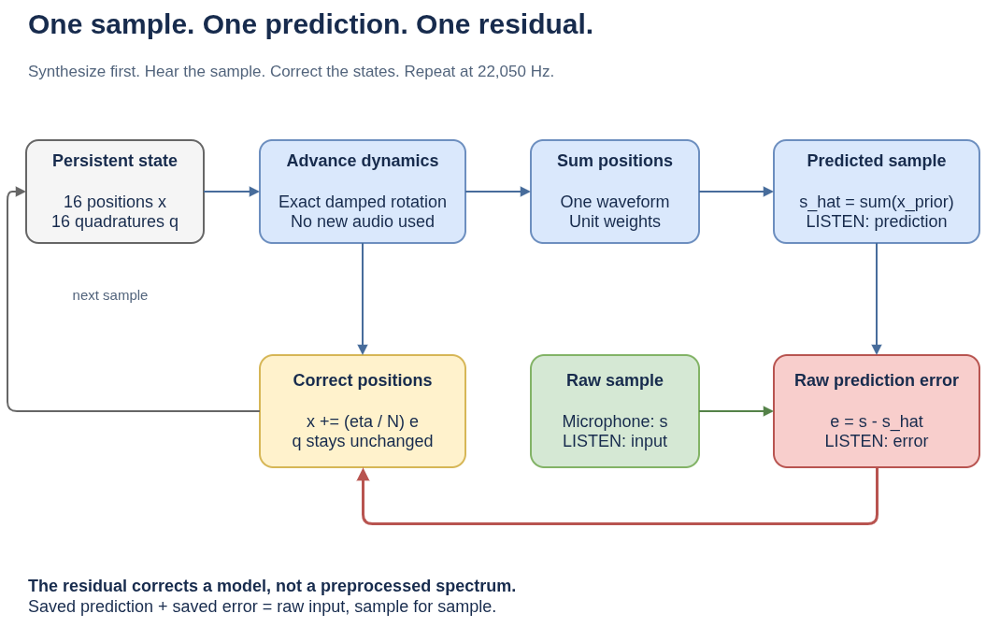
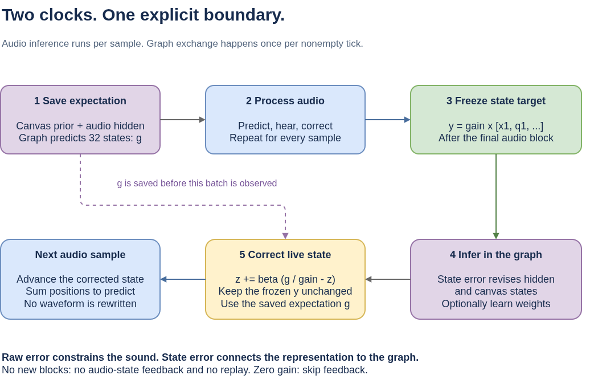
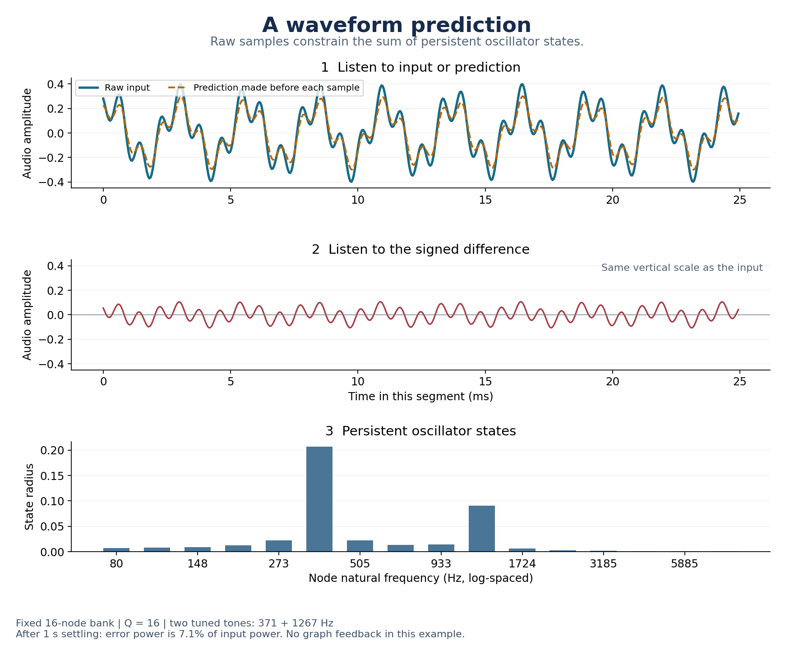

# Cochlea: predict the waveform

**Sixteen evolving oscillators predict one raw audio sample. Their sum is the
prediction; the difference from the microphone corrects their states.**
No spectrum, envelope, or rectification stands between the waveform and this
prediction error.



The blue route is synthesis. The red return is inference. The microphone
constrains the sum, not sixteen independently measured oscillator responses.
Position and quadrature remain signed.

## Try it

From the cochlea worktree, run the **standalone TUI**:

```bash
PYTHONPATH=src uv run --group tui python -m audioviz.tui.app --audio synthetic --no-camera
```

In settings, select **audio model: cochlea**. The switch resets the canvas and
graph weights and turns sound off. The spectral model remains the default.
This feature is in the local graph runtime; `main.py`'s Qt window and its
attached terminal controller retain their existing audio path.

| Sound out | Signal | Meaning |
| --- | --- | --- |
| `input` | $s_t$ | Original mono microphone or synthetic samples |
| `prediction` | $\hat s_t$ | Oscillator sum, saved before the corresponding sample corrects it |
| `error` | $s_t-\hat s_t$ | Signed raw-audio residual |
| `off` | Silence | Safe startup and model-switch default |

`evidence` is a compatibility alias for `input` in cochlea mode. In spectral
mode, `prediction`, `evidence`, and `error` are sine-bank sonifications;
`input` always plays the original waveform. Start at low volume with headphones
to avoid microphone-to-speaker feedback.

Playback applies the volume setting and clips to $[-1,1]$ at the speaker
boundary. It does not normalize each block. Internally, the saved prediction
and error remain unclipped, so $s_t=\hat s_t+e_t$ holds before playback gain.

The **prediction** tile overlays raw input in blue and causal prediction in
orange. The **error** tile uses the same amplitude scale, so a smaller residual
looks smaller, with a gray zero line. Both show the latest 128 samples (5.8 ms)
to make oscillations visible at terminal resolution. Waveform and spectrogram tiles
remain diagnostics; changing their analysis does not change cochlea inference.
The hidden tile shows the graph's audio-state decoder and hidden activity.

## One sample: dynamics, synthesis, analysis

### Fixed dynamics

For node $i$, position $x_i$ follows the unforced damped oscillator between
observations:

$$
\ddot x_i+2\gamma_i\dot x_i+\omega_i^2x_i=0,
\qquad
\omega_i=2\pi f_i,\quad
\gamma_i=\frac{\omega_i}{2Q},\quad
\nu_i=\sqrt{\omega_i^2-\gamma_i^2}.
$$

This is unit mass, damping $b_i=2\gamma_i$, stiffness $k_i=\omega_i^2$.
There is **no raw-audio forcing term**. Evidence enters through the error
correction below. $Q>1/2$ ensures underdamped dynamics.

We store position and a same-unit quadrature:

$$
q_i=\frac{\dot x_i+\gamma_i x_i}{\nu_i},
\qquad
\dot x_i=\nu_iq_i-\gamma_ix_i.
$$

Both coordinates carry temporal memory. Quadrature is not a second microphone
measurement and is not velocity in physical units.

With sample interval $\Delta=1/f_s$, the implementation uses the exact free
transition, not Euler integration:

$$
\begin{bmatrix}x^-_{i,t}\\q^-_{i,t}\end{bmatrix}
=
e^{-\gamma_i\Delta}
\begin{bmatrix}
\cos(\nu_i\Delta)&\sin(\nu_i\Delta)\\
-\sin(\nu_i\Delta)&\cos(\nu_i\Delta)
\end{bmatrix}
\begin{bmatrix}x^+_{i,t-1}\\q^+_{i,t-1}\end{bmatrix}.
$$

The envelope decay time is $1/\gamma_i=Q/(\pi f_i)$.
With shared $Q$, low-frequency states persist longer. All natural frequencies
must be strictly below Nyquist. Free oscillations occur at $\nu_i/(2\pi)$,
slightly below $f_i$.

### Synthesis: add positions

$$
\hat s_t=\sum_{i=1}^{N}x^-_{i,t},
\qquad e_t=s_t-\hat s_t,
\qquad E_t=\frac12e_t^2.
$$

Every synthesis weight is one. There is no inverse transform and no separate
vocoder in this path. The saved waveform prediction uses the **prior** positions,
not the positions after seeing $s_t$.

### Analysis: one residual correction

$$
x^+_{i,t}=x^-_{i,t}+\frac{\eta}{N}e_t,
\qquad q^+_{i,t}=q^-_{i,t}.
$$

This is a gradient step on $E_t$ in the stored coordinates, with step size
$\eta/N$. All nodes receive the same scalar residual; their different free
dynamics produce different histories. The correction does not infer velocity
from finite differences. Holding $q_i$ fixed implies a velocity change
$\Delta\dot x_i=-\gamma_i\Delta x_i$.

If the corrected positions were summed immediately, their residual would be
$(1-\eta)e_t$. That is an **after-observation fit**, not the saved prediction.
The listening output and reported residual never substitute that easier target.

For $0\leq\eta\leq1$, the zero-input correction is non-expansive in these
coordinates. The free transition contracts each node by
$e^{-\gamma_i\Delta}<1$. This bounds the isolated linear observer for bounded
input; it does not guarantee stability of the nonlinear graph with arbitrary
learning rates and gains.

## One graph tick: exchange state and expectation



There are two distinct errors. **Raw error** is the only direct acoustic
measurement error. **State error** couples the inferred oscillator representation
to the existing predictive graph; its target is an inferred state, not another
sensor measurement.

Let $z_B=(x_1,q_1,\ldots,x_N,q_N)$ be the state after processing the current
batch, $a$ the audio evidence gain, and $g_B$ the graph's saved expectation
in gain-scaled coordinates.

1. Propagate the canvas and save $g_B$ from the graph, before processing the
   batch's samples.
2. Process each sample in order with the equations above. Retain each block's
   prediction and residual for playback.
3. Freeze $y_B=a z_B$ as the audio branch's target. Run the existing joint
   camera/audio state inference and optional weight learning.
4. Apply one graph-prior correction to the live oscillator state:

$$
z_B^{\mathrm{next}}=z_B+\beta\left(\frac{g_B}{a}-z_B\right).
$$

This is a gradient step of size $\beta$ on
$\tfrac12\|z_B-g_B/a\|^2$, expressed in oscillator units. It affects the next
audio sample; it does not rewrite the frozen target or an already saved audio
prediction. The expectation used here is the saved **pre-observation** $g_B$,
not a decoder output fitted to $y_B$.

Feedback is skipped when $a=0$, the audio source is disabled, or no new block
arrives. Zero gain supplies a zero graph target while raw-audio inference and
listening continue. Missing blocks do not replay the previous prediction or
advance the sample clock.

The ordinary input block is 1024 samples at 22050 Hz, about 46.4 ms. A tick may
drain up to eight queued blocks; it forwards their waveforms in order and uses
the final block's state as one graph target. Thus graph feedback is **once per
nonempty tick**, not once per sample or once per queued block. The standalone
observer is block-partition independent; feedback depends on tick boundaries.
Input or output queue overflow can lose audio, so real-time execution matters.

This is a staggered two-rate inference scheme with a frozen local target. It
does **not** differentiate the raw waveform loss through the whole audio history
or train the graph by backpropagation through time. The existing graph provides
a pre-acquisition state expectation, not a calibrated 46.4 ms oscillator
forecast. Fast phase tracking is the cochlea's responsibility.

## What learns

**Oscillator parameters and synthesis weights do not learn in this first
version.** Frequencies, $Q$, $\eta$, $\beta$, and the unit summation weights
are fixed during a run. Oscillator states change even with graph learning off.

The existing audio branch can learn its canvas-to-hidden and hidden-to-state
weights. These equations specify the default path with cross-modal hidden
coupling disabled. Camera inference continues through its existing branch.

Let $p$ index $P$ canvas pixels, $c_p\in\mathbb R^3$, hidden state
$h_p\in\mathbb R^K$, $f=\tanh$, $W\in\mathbb R^{K\times3}$, and
$D\in\mathbb R^{2N\times K}$. The decoder pools over space:

$$
\mu=\frac1P\sum_p f(h_p),\qquad
\hat y=D\mu,\qquad
\epsilon_{h,p}=h_p-Wf(c_p),\qquad r=y_B-\hat y.
$$

Before acquiring audio, `predict` advances hidden memory once,
$h_p\leftarrow h_p+\alpha_h[Wf(c_p)-h_p]$, then saves $g_B=D\mu$.
During the bounded inference loop, $y_B$ stays fixed, weights stay fixed, and
all directions use the same pre-update canvas and hidden states:

$$
\Delta h_p=\alpha_h\left[-\epsilon_{h,p}
 +(1-f(h_p)^2)\odot(D^\mathsf{T}r+u\,d)\right],
$$

$$
\Delta c_p=\alpha_c(1-f(c_p)^2)\odot W^\mathsf{T}\epsilon_{h,p}.
$$

Here the unchanged stream-state node predicts audio ON/OFF:
$\pi=\operatorname{sigmoid}(u^\mathsf{T}\mu+b)$,
$m\in\{0,1\}$, and $d=(m-\pi)\pi(1-\pi)$.
Its supervision continues when no waveform arrives; then $r=0$.
The camera branch contributes its own canvas direction to the same simultaneous
update. The net canvas correction is applied to both wave buffers, preserving
wave velocity.

The audio updates correspond to the normalized branch energy

$$
E_{\mathrm{branch}}=
\frac{1}{2P}\sum_p\|\epsilon_{h,p}\|^2
+\frac12\|r\|^2+\frac12(m-\pi)^2,
$$

with state-gradient steps scaled by $P$. Diagnostic energy reporting retains
the existing channel-averaged convention; it is not this exact scalar objective.

After the last local inference step, recompute the errors. When **learning** is
on, the weight directions are:

$$
G_W=\frac1P\sum_p\epsilon_{h,p}f(c_p)^\mathsf{T},\qquad
G_D=r\mu^\mathsf{T},\qquad
G_u=d\mu,\qquad G_b=d.
$$

For each learned parameter $\theta$, the existing update is

$$
\theta\leftarrow
\operatorname{clip}\!\left(
\theta+\lambda\operatorname{clip}(G_\theta-\rho\theta,-G_{\max},G_{\max}),
-W_{\max},W_{\max}\right).
$$

Learning is off by default. With no new audio target, $D$ is frozen; hidden,
canvas, and stream-state inference can continue. Resetting graph states retains
weights; changing the audio representation rebuilds the graph and its weights.

### Optional cross-modal hidden coupling

This existing option is off by default. For branches $b$ and $j$ (audio and
camera), let $C_{bj}$ predict $b$'s hidden state from $j$:

$$
\epsilon^b_{h,p}=h^b_p-W_bf(c_p)-C_{bj}f(h^j_p).
$$

Add $C_{jb}^\mathsf{T}\epsilon^j_{h,p}$ inside $b$'s hidden feedback term,
alongside sensory and stream-state feedback. Its weight direction is

$$
G_{C_{bj}}=\frac1P\sum_p\epsilon^b_{h,p}f(h^j_p)^\mathsf{T}.
$$

Apply the same clipping/decay rule. When capturing the pre-observation
expectation with coupling enabled, use one simultaneous hidden step with
hidden-error and cross-feedback terms only; then decode $g_B$. Thus no current
sensory target participates in that step. The coupling does not add an audio
preprocessing stage.

## Defaults and limits

| Parameter | Initial value | Responsibility |
| --- | --- | --- |
| $N$ | 16 | Oscillators; 32 signed graph coordinates |
| $f_i$ | Geometric spacing, 80 to 8000 Hz | Fixed natural frequencies |
| $Q$ | 16, shared | Frequency selectivity and memory |
| $\eta$ | 0.5 | Raw error correction; divided by $N$ per node |
| $\beta$ | 0.05 | One graph-prior correction per nonempty tick |
| $a$ | 1 | Graph coordinate scale, not a raw-audio gain |
| $f_s$ | 22050 Hz in the local TUI | Audio sample clock |

For $N>1$,
$f_i=f_{\min}(f_{\max}/f_{\min})^{i/(N-1)}$, $i=0,\ldots,N-1$;
the single-node configuration uses $f_{\min}$. The bank API accepts other
sample rates and validated configurations. The local TUI uses these defaults.

One scalar error does not uniquely identify every oscillator contribution.
Distinct dynamics supply a useful bias, not a proof that the learned
representation is unique or biologically faithful. A sparse fixed bank cannot
closely predict every frequency, attack, speech segment, or noise signal.
No representation-learning or state-of-the-art audio claim is made.



This example uses two bank-tuned tones, a one-second settling period, and no
graph feedback. Input and residual share the same amplitude scale.
It demonstrates causal tracking, not general audio reconstruction quality.

## Reproduce and inspect

```bash
PYTHONPATH=src uv run python scripts/validate_cochlea.py
uv run --group dev python -m pytest -q \
  tests/audio_processing/test_cochlea.py tests/tui/test_cochlea_runtime.py
```

The script writes a figure, metrics, and sample-aligned `input.wav`,
`prediction.wav`, and `error.wav` into `outputs/cochlea/`. It checks core
processing faster than real time on the current machine and a residual-power
threshold for the two-tone example. It does not measure hardware round-trip
latency or guarantee real-time performance of a large canvas.

The editable diagram has two pages:
[cochlea.drawio](./cochlea.drawio). Open it in VS Code with the draw.io extension,
or in draw.io desktop; double-click a label to edit it.

| Responsibility | Implementation |
| --- | --- |
| Dynamics, synthesis, raw inference | `src/audioviz/audio_processing/cochlea.py` |
| Raw input and diagnostic spectra | `src/audioviz/audio_processing/audio_processor.py` |
| Signed graph target | `src/audioviz/sources/audio.py` |
| Pooled state decoder | `src/audioviz/readouts/audio.py` |
| Graph inference and weight updates | `src/audioviz/readouts/predictive_coding.py` |
| Two-rate scheduling and feedback | `src/audioviz/tui/graph_runtime.py` |
| Ordered input blocks and listening taps | `src/audioviz/tui/audio_feed.py`, `audio_out.py` |

The diagrams and equations describe the implementation in this worktree.
The local HTML preview renders this original Markdown through Agent Doc Review;
no interactive controls are needed to explain the state and timing boundaries.
