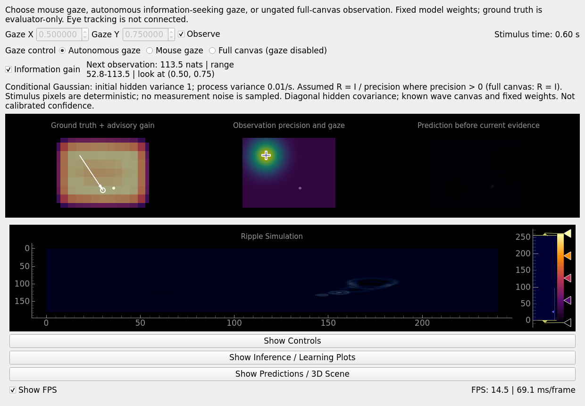

# Active vision: gaze modes, advisory information gain, and headless evaluation

**Status: Historical Gaussian and shared-graph experiment reference.**
This is not the current continuous-scene application contract. See the
[experiments index](README.md) for current evidence and next steps, and the
[model reference](../continuous-scene-reference.md) for current runtime behavior.

This implements the stimulus and Stage A foundation of [the research
proposal](https://github.com/EternalGoldenBraid/AudioViz/pull/1), an
expected-information-gain estimator, three mutually exclusive experiment gaze
modes (`mouse`, `autonomous`, and `full`), and a headless policy comparison
runner. It does not implement calibrated predictive covariance, a learned
circular-motion predictor, or a physical-camera navigation policy.

## Mathematics diagram and source map

Open [the editable mathematics diagram](../predictive-uncertainty-math.drawio)
in the VS Code draw.io extension or draw.io desktop. Its five pages cover
terms/distributions, visual forecast/conditioning, the sensory information
objective, the common-mode temporal Gaussian audio filter over a shared latent
wave medium, and the opt-in shared learned Gaussian sensory/latent graph with
exact hard evidence clamps. The diagram describes the implementation at code
snapshot `c36a20a`, including its approximation boundaries. **Page 5 is historical:**
the shared runner now uses the generative predictive-coding model described
[below](#shared-generative-predictive-coding), not that joint
Gaussian experiment. The source-map line anchors below also refer to that
snapshot; current shared PC code is in
[`shared_predictive_coding.py`](../../src/audioviz/readouts/shared_predictive_coding.py),
with circular foveal root routing, persistent full-image prediction buffer updates,
and adjoint gradient scatter in
[`shared_sensory_io.py`](../../src/audioviz/readouts/shared_sensory_io.py).

Each blue code label is a clickable `vscode://file/...:line:column` link into
this checkout at `/home/nicklas/Projects/AudioViz`. These local links work
without publishing the implementation to GitHub; if the checkout moves,
replace that root in the diagram. The repository-relative source links below
are the portable index. Function names remain useful if line numbers move.

| Mathematical responsibility | Implementation |
| --- | --- |
| Known canvas projection & ordinary PC mean prediction (when Gaussian filter is off) | [`PredictiveCodingRGBReadout.predict`](../../src/audioviz/readouts/predictive_coding.py#L139-L145), [`OpenGLPredictiveModel._advance`](../../src/audioviz/readouts/opengl_predictive.py#L271-L299) |
| Predicted sensory mean | [`_capture_prediction`](../../src/audioviz/readouts/predictive_coding.py#L147-L156), [`_predict_observation`](../../src/audioviz/readouts/predictive_coding.py#L333-L334) |
| Temporal Gaussian initialization, assumptions, and exact OU transition | [`GaussianSensoryUncertainty.__init__`](../../src/audioviz/readouts/gaussian_uncertainty.py#L33-L70), [`validate_config`](../../src/audioviz/readouts/gaussian_uncertainty.py#L73-L75), [`_transition`](../../src/audioviz/readouts/gaussian_uncertainty.py#L77-L87) |
| Shared OU hidden-mean / covariance forecast and frozen pre-evidence mean | [`GaussianSensoryUncertainty.predict`](../../src/audioviz/readouts/gaussian_uncertainty.py#L108-L149) |
| Decoder Jacobian and RGB covariance components | [`_jacobian` / `_components`](../../src/audioviz/readouts/gaussian_uncertainty.py#L151-L159) |
| Joint frozen-affine Gaussian conditioning, hidden-diagonal projection, and deterministic canvas feedback | [`GaussianSensoryUncertainty.condition`](../../src/audioviz/readouts/gaussian_uncertainty.py#L161-L221), [`_condition_native`](../../src/audioviz/readouts/gaussian_uncertainty.py#L223-L297), [`_finish_inference`](../../src/audioviz/readouts/predictive_coding.py#L184-L269), [`_diagnostics`](../../src/audioviz/readouts/opengl_predictive.py#L561-L613) |
| Gaze-conditioned scalar precision | [`GaussianSpatialPrecision.field`](../../src/audioviz/readouts/spatial_precision.py#L46-L58) |
| Normalized Gaussian measurement likelihood | [`negative_log_likelihood`](../../src/audioviz/readouts/spatial_precision.py#L60-L75) |
| Planning forecast, RGB log-determinant, and pixel-area quadrature | [`expected_information_gain`](../../src/audioviz/readouts/gaussian_uncertainty.py#L322-L432), [`_pixel_area_weights`](../../src/audioviz/readouts/gaussian_uncertainty.py#L491-L496) |
| Native moments and candidate-score reduction | [GLSL inside `expected_information_gain`](../../src/audioviz/readouts/gaussian_uncertainty.py#L377-L427) |
| Freshness-gated 16-band audio observation and common-mode temporal Gaussian audio filter | [`AudioRippleSource.observation`](../../src/audioviz/sources/audio.py#L80-L93), [`spectral_observation`](../../src/audioviz/utils/audio_features.py#L9-L36), [`GaussianAudioUncertainty.predict`](../../src/audioviz/readouts/gaussian_audio_uncertainty.py#L131-L189), [`_pooled_jacobian` / `_solve_common_mode`](../../src/audioviz/readouts/gaussian_audio_uncertainty.py#L191-L209), [`condition` / `_condition_native`](../../src/audioviz/readouts/gaussian_audio_uncertainty.py#L211-L360), [`expected_information_gain`](../../src/audioviz/readouts/gaussian_audio_uncertainty.py#L362-L430) |
| Opt-in shared learned Gaussian sensory/latent graph, hard-clamp conditioning, masked online moment/EM learning, finite hidden-target MI, and compact I/O | [`SharedGraphSnapshot` / `SharedSensoryGraph.__init__`](../../src/audioviz/readouts/shared_sensory_graph.py#L11-L179), [`SharedSensoryGraph.forecast`](../../src/audioviz/readouts/shared_sensory_graph.py#L237-L254), [`_conditional_gaussian` / `condition`](../../src/audioviz/readouts/shared_sensory_graph.py#L314-L426), [`information_gain` / `belief_snapshot`](../../src/audioviz/readouts/shared_sensory_graph.py#L454-L539), [`SharedSensoryBranch` / `SharedSensoryIO`](../../src/audioviz/readouts/shared_sensory_io.py#L8-L146) |
| Bounded host belief snapshots (`VisualBeliefSnapshot` / `AudioBeliefSnapshot` / `SharedGraphSnapshot`) and live diagnostics view | [`VisualBeliefSnapshot` / `GaussianSensoryUncertainty.belief_snapshot`](../../src/audioviz/readouts/gaussian_uncertainty.py#L15-L22), [`AudioBeliefSnapshot` / `GaussianAudioUncertainty.belief_snapshot`](../../src/audioviz/readouts/gaussian_audio_uncertainty.py#L432-L477), [`BeliefDiagnosticsView`](../../src/audioviz/visualization/belief_diagnostics_view.py#L24-L342) |
| Greedy tie/flat-score handling and policy selection | [`ActiveVisionConfig`](../../src/audioviz/sources/gaze.py#L11-L35), [`has_gaze_preference`](../../src/audioviz/sources/gaze.py#L38-L39), [`information_gaze`](../../src/audioviz/sources/gaze.py#L42-L55), [`GazePolicy.select`](../../src/audioviz/sources/gaze.py#L69-L82) |
| Opt-in temporal Gaussian & shared-graph wiring, pre-capture gaze selection, and synchronous dual-branch conditioning | [`predict_visual`](../../src/audioviz/sources/orchestrator.py#L203-L221), [`_select_visual_gaze` / `visual_information_gain`](../../src/audioviz/sources/orchestrator.py#L223-L259), [`enable_visual_uncertainty`](../../src/audioviz/sources/orchestrator.py#L261-L291), [`correct_from_observations`](../../src/audioviz/sources/orchestrator.py#L320-L383) |
| Shared gaze controls, live main-visualizer integration, attention overlay, responsive preview reflow, advisory cue, and finite-run restart | [`build_ripple_visualizer_config`](../../main.py#L190-L282), [`main`](../../main.py#L393-L521), [`GazeControls`](../../src/audioviz/ui/gaze_controls.py#L8-L112), [`AttentionOverlay`](../../src/audioviz/visualization/attention_overlay.py#L29-L133), [`RippleWaveVisualizer._refresh_attention_preview` / `_shared_belief_frame`](../../src/audioviz/visualization/ripple_wave_visualizer.py#L569-L642), [`_advance_canvas`](../../src/audioviz/visualization/ripple_wave_visualizer.py#L869-L932), [`_capture_scene_sources`](../../src/audioviz/visualization/ripple_wave_visualizer.py#L934-L986), [`resizeEvent`](../../src/audioviz/visualization/active_vision_experiment.py#L164-L176), [`_change_gaze_mode` / `_update_precision`](../../src/audioviz/visualization/active_vision_experiment.py#L178-L192), [`_update_advisory_marker`](../../src/audioviz/visualization/active_vision_experiment.py#L210-L257), [`_after_frame` / `refresh_previews` / `_restart`](../../src/audioviz/visualization/active_vision_experiment.py#L276-L344), [`main`](../../src/audioviz/visualization/active_vision_experiment.py#L353-L389) |
| Headless fixed/random/autonomous evaluation and metrics | [`GazeFrameMetrics` / `GazeRunResult`](../../src/audioviz/offline/active_vision.py#L22-L38), [`run_gaze_comparison`](../../src/audioviz/offline/active_vision.py#L75-L164), [`main`](../../src/audioviz/offline/active_vision.py#L167-L226) |
| Dense/scalar affine references, common-mode low-rank audio oracle, shared-graph hard-clamp & masked-EM oracles, OU partition invariance, native parity, and quadrature ranking oracle | [`test_model_transition_and_frozen_decoder_match_dense_gaussian_reference`](../../tests/readouts/test_gaussian_uncertainty.py#L54-L107), [`test_bounded_gain_preserves_full_grid_action_ranking_after_repeated_center_observations`](../../tests/readouts/test_gaussian_uncertainty.py#L184-L215), [`test_temporal_posterior_and_scores_match_scalar_affine_oracle_independently_of_solver`](../../tests/readouts/test_gaussian_uncertainty.py#L219-L282), [`test_common_mode_audio_matches_dense_low_rank_posterior_and_replication_invariance`](../../tests/readouts/test_gaussian_uncertainty.py#L337-L447), [`test_dense_hard_clamp_conditioning_and_masked_em_match_oracle`](../../tests/readouts/test_shared_sensory_graph.py#L9-L107), [`test_finite_target_hidden_mutual_information_and_cupy_parity`](../../tests/readouts/test_shared_sensory_graph.py#L157-L207), [`test_temporal_mean_and_covariance_match_exact_ou_independently_of_step_partition`](../../tests/readouts/test_gaussian_long_run.py#L10-L38), [`test_shader_uncertainty_matches_gaussian_reference_and_downloads_only_gain_grid`](../../tests/readouts/test_opengl_predictive.py#L219-L292), [`test_shader_audio_uncertainty_matches_reference_and_preserves_pre_evidence_canvas`](../../tests/readouts/test_opengl_predictive.py#L327-L399) |

In the diagram, `lambda` is the scalar precision field called `Pi(r)` below;
the RGB precision matrix is `lambda * I_3`. `m` is the hidden point estimate
stored in `readout.hidden`, while `h` denotes the uncertain hidden variable.
`v = diag(P)` extracts the stored variance vector; `P = Diag(v)` constructs
the conceptual diagonal covariance matrix. These are different operations.

## Run

```bash
uv run python -m audioviz.visualization.active_vision_experiment --backend opengl --gaze-mode mouse --gaze 0.8 0.5
```

OpenGL 4.3 is required for the shader backend. `--backend numpy` and
`--backend cupy` run the same inference semantics on the existing array
backends. No camera, microphone, or video codec is required.



The top panels show evaluator ground truth with an optional information-gain
overlay, the Gaussian precision field over
that frame with a gaze cross, and the model's prediction **before the current
frame was incorporated** (aligned in three columns on wide windows `>= 1000 px`
and stacked vertically on narrower windows). The lower canvas is the existing corrected wave
surface. The model weights remain fixed by default. Controls select one of
three mutually exclusive gaze modes and whether to observe (`Observe` remains
an independent gate across all modes):

- **Mouse gaze (`--gaze-mode mouse`, default):** hover over any of the three
  preview images while **Mouse gaze** is selected, or position gaze with the
  numeric controls. Image coordinates account for
  scaling and the inverted image Y axis; moving into the surrounding margins
  leaves gaze unchanged.
- **Autonomous gaze (`--gaze-mode autonomous`):** selects the greedy maximum of
  the expected-information-gain candidate grid at model-step cadence in
  `RippleSourceOrchestrator.predict_visual` before each camera frame is
  captured (not throttled to the 10 Hz preview timer). When `Observe` is off,
  or when all candidates tie / have zero expected gain (within relative
  `1e-6` float32 tolerance), autonomous gaze remains frozen at its current
  position; non-flat ties keep the current gaze if it is among the maximizers
  and otherwise use the first near-maximizer in row-major order. The preview
  arrow uses this same selector. It never reads evaluator ground truth or the
  unsampled current frame.
- **Full canvas (`--gaze-mode full`):** disables spatial gating and applies
  uniform unit precision (`Pi(r) = 1`, `R(r) = I_3`) across the entire frame
  whenever `Observe` is on; switching back to `mouse` or `autonomous` restores
  the Gaussian profile. This is distinct from turning `Observe` off
  (`Pi(r) = 0`, no observation update).

**Information gain** toggles the overlay. Brighter cells indicate
greater expected uncertainty reduction from an observation centered there;
the white circle marks the highest-scoring candidate, and the arrow points
from current gaze toward it. The status row reports total gain in nats and
normalized target coordinates. The heatmap is scaled to its current score
range; brightness is not an absolute confidence scale. No direction is shown
when there is no expected gain or when all candidates tie. Advice and
autonomous selection are restricted to this synthetic image grid, not a
physical-camera navigation plan.
Gaussian width and baseline/peak precision
remain fixed for the run. The stimulus stops after its configured duration
(`--duration`, default `10` s), stopping both the model and preview timers and
showing `Finished: <N> frames - Restart to continue` (during the run, the
status shows `Stimulus time: <elapsed> / <duration> s`). Switching gaze modes
after a run finishes does not automatically restart timers or reset history;
use **Restart** (`ActiveVisionExperiment._restart`) to replay the seeded
stimulus and reset wave/readout/covariance beliefs while preserving the
selected gaze mode, gaze coordinates, and `Observe` state. Previews update at
most 10 Hz and have a maximum side of 256 pixels (the committed
`active-vision-bench.png` screenshot reflects the `b427020` UI snapshot).

```bash
uv run python -m audioviz.visualization.active_vision_experiment \
  --backend opengl --resolution 240 320 --fps 30 --duration 20 \
  --brownian-scale 3 --seed 7 --sigma 0.15 --baseline 0.01 --peak 1 \
  --memory-time-constant 0.333333
```

The frame clock advances by `1 / fps` for every generated frame, independent
of wall-clock rendering speed. Display FPS therefore need not equal stimulus
FPS. Parameters are experimental settings, not calibrated camera-noise
estimates.

### Historical shared-PC application

Run `python main.py` without model-selection flags. In `main.py`,
`RIPPLE_CONFIG["model"]` groups `foveal_radius` (default `32` pixels),
`hidden_units` (default `6` total recurrent units), and `memory_time_constant`.
`RIPPLE_CONFIG["gaze"]` contains `mode` (`mouse` or `autonomous`) and normalized
`position`; source and window configuration independently control camera/audio
availability and audio-device initialization. Size changes require restarting.
At the snapshot described here, the normal entrypoint used
`SharedPredictiveCodingGraph`; current main uses the continuous-scene model.

The established per-pixel application is preserved at local `main` (`e0994e8`)
in the sibling `AudioViz-baseline` worktree. Use separate project environments
for the two worktrees so editable imports resolve to the intended source tree.
The feature branch no longer exposes alternate models through launch flags.
The following flag-based integration and Gaussian filter sections describe
historical behavior and retained experimental APIs, not current `main.py` usage.

### Historical flag-based integration (through `8f935ce`)

```bash
python main.py --active-vision mouse
python main.py --active-vision mouse --active-audio
python main.py --active-vision mouse --active-audio --shared-sensory-graph
```

Passing `--active-vision {mouse,autonomous,full}` (or enabling
`RIPPLE_CONFIG["active_vision"]` in `main.py`, disabled by default with knobs
`mode`, `gaze`, `foveal_radius`, `sigma`, `baseline`, `peak`, `initial_variance`,
`process_variance`, `memory_time_constant`, optional `audio_precision`, and
optional `shared_sensory_graph`) launches a live active-vision session in
`RippleWaveVisualizer` using the shared `GazeControls` widget and either the
fixed-weight two-branch filter (`GaussianSensoryUncertainty` + optional
`GaussianAudioUncertainty`) or the opt-in foveal generative PC network
(`SharedPredictiveCodingGraph` + `SharedSensoryIO`):

- **Default camera-only profile (`--active-vision` without `--active-audio`, `audio_precision=None`):**
  skips audio hardware/device initialization (`_create_audio_processor` is not
  called), disables the spectrogram and pitch-helix windows and ripple audio,
  and enables camera and ripple while preserving the configured backend
  (`numpy`, `gpu`, or `opengl`) and other field/model settings. Ordinary
  `python main.py` remains unchanged. Enforces the uncoupled visual-only model
  contract: rejects an audio `processor` or ripple audio drive unless
  `audio_precision` is explicitly configured, and rejects weight
  learning (unless `--shared-sensory-graph` is active), cross-modal hidden
  coupling, or disabled camera prediction-error inference.
- **Opt-in common-mode audio profile (`--active-vision ... --active-audio` or `audio_precision` set to a positive finite float):**
  initializes the audio processor and routes it to `RippleWaveVisualizer`
  alongside `GaussianAudioUncertainty` (default `audio_precision = 1.0` when
  `--active-audio` is passed). **Observe vision** in `GazeControls` and the
  **Audio** source toggle remain independent gates.
- **Opt-in shared generative predictive-coding graph (`--active-vision {mouse,autonomous} --shared-sensory-graph`, with `--active-audio` optional):**
  replaces the separate per-pixel visual and common-mode audio hidden fields
  with one foveal generative network (`SharedPredictiveCodingGraph` +
  `SharedSensoryBranch` + `SharedSensoryIO`, detailed below) over a fixed integer
  circular disk stencil configured by `active_vision.foveal_radius` (default `8`
  pixels, integer `1..16`, yielding `K = 197` static RGB disk slots = `591`
  visual nodes by default, passed to `SharedPredictiveCodingGraph` as
  `visual_shape=(K, 1)`). The routed wave canvas patch is its root, not an
  auxiliary display downstream of a Gaussian filter. `full` gaze mode is
  explicitly rejected in `--shared-sensory-graph` (only `mouse` and `autonomous`
  are valid; there is no full-image weight expansion), and `GazeControls` hides
  the Gaussian `sigma`, `baseline`, `peak`, and `full`-mode controls because
  evidence is gathered uniformly over the in-bounds circular disk (`ActiveVisionConfig`
  also rejects custom `audio_precision not in (None, 1.0)` when
  `shared_sensory_graph=True`). **Shared Predictive Coding** in **Controls**
  exposes the active settling-step count/rate, generative weight learning, and
  canvas gradient-feedback rate. It honors the prediction-error learning
  configuration; learning is not silently enabled by this flag.
- **Interactive gaze, foveal profile, and overlays:** `GazeControls` is hosted
  inside the **Controls** panel (preserving widget state when closing/reopening)
  and exposes live `pg.SpinBox` controls for foveal width (`sigma`), peripheral
  baseline (`baseline`), and foveal increment (`peak`). Mouse movement over the
  main wave canvas or the 2D prediction/camera comparison images maps to
  normalized `[0, 1]^2` gaze coordinates (ignoring surrounding viewport
  margins). A mouse-transparent `AttentionOverlay` draws the current gaze cross,
  the `1-sigma` foveal outline (one physical fovea, even when the EIG surface
  has multiple local maxima), and an image-space advisory arrow toward the
  highest-IG candidate (suppressed when all candidates tie/are flat, when the
  current gaze is already among the near-maximizers, or when camera capture is
  unavailable). This arrow is an image-space uncertainty-reduction cue, not
  calibrated eye tracking, action probabilities, or a physical head-pose/motor
  command.
- **Camera failure latching:** if camera open or frame read fails,
  `CameraFrameSource` logs once, releases the failed handle, and latches into a
  no-evidence state without retrying hardware opens on every frame. The default filter
  continues its OU forecast (`delta_m = 0`, `delta_canvas = 0`), and the UI
  prompts to toggle **Camera Frame** off and on to retry. Shared PC instead
  continues intrinsic energy settling without a visual evidence term.
- **Toolbar and live numerical diagnostics (`BeliefDiagnosticsView`):** the
  canvas toolbar provides **Controls**, **Predictions**, and **Diagnostics**
  plus a compact mode/status footer. In the default filter profile, **Diagnostics** polls
  bounded `10 Hz` host snapshots (`VisualBeliefSnapshot` and
  `AudioBeliefSnapshot` via `belief_snapshot()`) and prospective `10 Hz` visual
  / scalar audio EIG scores (evaluated on the current stored posterior with held
  `engine.get_prior()` and last `dt`, labeled as **global sound potential EIG**
  to distinguish counterfactual information gain while the audio source is off),
  displaying the model-gaze EIG surface (scores in nats, not probabilities),
  Gaussian marginal mean/std/variance, stored diagonal hidden covariance, and
  linearized sensory signal covariance `V = J P J^T` (**excluding** observation
  noise `R`), along with exact-pixel and `forecast`/`posterior` stage metadata.
- **Clock and scope boundaries (default filter):** advances the live hidden-state filter timestep
  `dt` by the nominal timer interval (`timer.interval() / 1000` s) on the first
  frame and immediately after reset, and by monotonic frame-to-frame elapsed
  time (`time.monotonic()`) at each subsequent prediction step
  (`predict_visual(dt=elapsed)`), supplying the identical `dt` to autonomous
  gaze planning and both visual and audio OU forecasts. The deterministic
  synthetic experiment continues to use fixed `dt = 1 / stimulus.frame_rate`,
  and the wave surface continues to step on its separate deterministic CFL
  timestep. Fixed weights cannot learn emergent modality-specialized spatial
  regions. This live mode makes no moving-target pursuit, noise-calibration, or
  real-time 1080p performance claim.

## Stimulus contract

`CircularDotSource` generates raw, read-only BGR `uint8` frames and separate
evaluator samples containing time, true pixel position, and Brownian offset.
Coordinates are `(x, y)`; resolution is `(rows, columns)`. The default center
is the center of the pixel grid.

The nominal trajectory is
`center + radius * (cos(phase + angular_velocity*t), sin(...))`.
Angular velocity is in radians/second. The first Brownian offset is zero;
subsequent independent increments have distribution
`Normal(0, brownian_scale^2 * dt * I)`, with scale in pixels/sqrt(second).
The seed controls only the evaluator's generator. Zero scale gives the exact
unperturbed trajectory. Positions can leave the image; only the rasterized
disk is clipped, and a fully off-frame dot produces a black frame.
There are `ceil(duration * fps)` samples, starting at time zero.

`CircularDotCapture` adapts this source to the existing camera `read/release`
interface, returning frames only. The generator's seed and true coordinates
are not passed to predictive inference. Ground truth and debugging previews
belong to the evaluator; they must not become inputs to a future gaze policy.
This experiment adds no changes to the production camera capture path.

## Precision contract

```python
from audioviz.readouts import GaussianSpatialPrecision, PredictiveCodingConfig

precision = GaussianSpatialPrecision(
    gaze=(0.8, 0.5), sigma=0.15, baseline=0.01, peak=1.0,
)
config = PredictiveCodingConfig(dtype="float32", spatial_precision=precision)
```

Gaze coordinates range from zero to one along each image axis, with endpoints
at the first/last pixel centers. Sigma is measured as a fraction of the
shorter image dimension, preserving a circular Gaussian in pixel space.
For pixel position `r` and gaze center `g`:

```text
Pi(r) = baseline + peak * exp(-0.5 * ||(r - g) / sigma_pixels||^2)
```

The field is shared across RGB channels. `spatial_precision=None` preserves
the existing unit-precision behavior exactly. Audio observations retain unit
precision and are not spatially gated.
Integral parameter values such as `peak=1` or `gaze=(0, 1)` are valid; the
shader adapter uploads all continuous precision parameters as GLSL floats.

- Sensory feedback and sensory decoder learning use `Pi * (observation - prediction)`.
- Sensory energy is `0.5 * Pi * error^2`, not `0.5 * (Pi * error)^2`.
- Diagnostic sensory energy means/variances follow that same weighted energy.
- Raw error arrays remain raw residuals for compatibility and evaluator inspection.
- `sample=False` sets all spatial precision to zero without stopping the stimulus,
  clearing beliefs, or turning off wave/internal dynamics. The camera's ON/OFF
  context node remains separate from the choice to sample.

NumPy/CuPy cache the field on their own array backend. OpenGL evaluates it
directly in GLSL from gaze and scalar precision parameters; it does not upload
or download a full precision image for inference. The optional CPU field in
the demo is evaluator visualization only.

`precision.negative_log_likelihood(observation, prediction)` supplies the
normalized independent-Gaussian observation likelihood:

```text
NLL = 0.5 * sum(Pi * error^2 + log(2*pi) - log(Pi))
```

This sums over observed RGB dimensions. Exactly zero precision denotes a
missing dimension, excluded from both quadratic and normalization terms;
skipping every dimension gives NLL zero. Positive precision means inverse
observation variance, not predictive belief variance. Observation likelihood
normalization matters when comparing gaze actions, even though its constant
does not affect fixed-gaze state gradients.

The Gaussian spatial envelope is not itself a Gaussian belief over future
dot positions. Brownian motion perturbs the trajectory, not the observation
noise. Do not give a gaze policy the evaluator's raw frames, true positions,
or raw diagnostic residuals.

**Deterministic stimulus pixels do not imply `R = I_3`:** a deterministic
synthetic frame is a noiseless scene realization (zero empirical sampling
jitter across repeats of the same seed); taken literally as a noise distribution
that would approach a degenerate `R -> 0` where Gaussian log-likelihood is
singular. Instead, `R_a(r) = (1 / Pi_a(r)) * I_3` is the **assigned
observation-likelihood covariance** that weights prediction errors in the
variational objective and sets the signal-to-noise ratio in information
scoring:

- In spatial gaze modes (`mouse`, `autonomous`), `Pi_a(r)` varies by pixel so
  `R_a(r) = (1 / Pi_a(r)) * I_3` on observed dimensions (`Pi_a(r) > 0`).
- In `full` canvas mode (`spatial_precision=None` or uniform unit precision),
  `Pi(r) = 1` assigns `R(r) = I_3` everywhere by unit-precision convention,
  not because deterministic pixels inherently have unit variance.
- When `Observe` is off (`sample=False`), `Pi(r) = 0` everywhere (unobserved;
  not inverted, and posterior mean/covariance remain `m_posterior = m_prior`,
  `P_posterior = P_prior`).

## Advisory Gaussian belief

The inference objective already has a Gaussian observation-likelihood
interpretation: the predicted image is its conditional mean, and observation
covariance is `R = diag(1 / Pi)` over observed dimensions. The existing energy
statistics are not predictive covariance.

The experiment opts into a **conditional temporal Gaussian filter**
(`GaussianSensoryUncertainty`) via
`source_orchestrator.enable_visual_uncertainty(dt=1 / fps, initial_variance=1.0, process_variance=0.01, memory_time_constant=1 / 3)`.
Ordinary predictive-coding entrypoints (`visual_uncertainty is None`) keep their
existing multi-step `infer_joint` mean-settling behavior unchanged and incur no
covariance-update cost. When enabled, each pixel has a hidden mean `m` (stored
in `readout.hidden`) and diagonal hidden-state covariance `P = Diag(v)` (stored
in float32 on the inference backend) governed by an exact Ornstein-Uhlenbeck
(OU) transition with physical memory time constant `tau`
(`--memory-time-constant`, default `1 / 3` stimulus seconds, completely
independent of the predictive-coding solver `inference_rate` and
`inference_steps`):

```text
rho = exp(-dt / tau)
Q(dt) = 0.5 * D * tau * (1 - exp(-2 * dt / tau))
m_prior = rho * m_posterior + (1 - rho) * W_canvas * tanh(canvas)
P_prior = rho^2 * P_posterior + Q(dt) * I
y_prior = W_visual * tanh(m_prior)
J = W_visual * Diag(1 - tanh(m_prior)^2)
V_sensory = J * P_prior * J^T
```

The full local `3 x 3` RGB covariance `V_sensory` is retained for information
scoring; RGB correlations induced by the decoder are not discarded. Given an
observation `Y` with scalar precision `Pi`, one frozen-affine Extended Kalman
Filter (EKF) update conditions **both** the hidden mean and covariance jointly,
projects the posterior covariance onto its diagonal, and returns deterministic
observer feedback for the next frame's known wave input:

```text
S = I_3 + Pi * V_sensory
delta_m = Pi * P_prior * J^T * inverse(S) * (Y - y_prior)
m_posterior = m_prior + delta_m
C = P_prior - Pi * P_prior * J^T * inverse(S) * J * P_prior
v_posterior = diag(C)
P_posterior = Diag(v_posterior)
delta_canvas = canvas_rate * (1 - tanh(canvas)^2) * (W_canvas^T * delta_m)
IG(action) = 0.5 * sum_pixels(log(det(I_3 + Pi(action) * V_sensory)))
```

Here `D` is the scalar diffusion intensity `process_variance` (default `0.01` in
hidden-state variance per stimulus second), `tau` is `memory_time_constant`
(default `1 / 3` s), and `initial_variance` `v_0` (default `1.0`) is configured
independently of the stationary unobserved prior variance
`v_inf = 0.5 * D * tau ≈ 0.001667`. Under this exact held-drive OU transition,
multi-step unobserved propagation is invariant to how elapsed time is
partitioned into steps `dt` (`test_gaussian_long_run.py`). For a linear
decoder (`W_visual * h`), `(m_posterior, C)` is the exact one-step conditional
Gaussian posterior (and for the nonlinear `W_visual * tanh(h)` decoder, it is
the exact posterior of the frozen-affine likelihood linearized once at
`m_prior` before current evidence), whereas the stored
`P_posterior = Diag(diag(C))` is a diagonal projection that drops cross-channel
hidden correlations induced by mixed `W_visual` (an identity decoder is exact
for the diagonal entropy oracle because `C` is already diagonal there). The
information-gain expression `0.5 * log(det(I_3 + Pi * V_sensory))` is the exact
sensory/hidden entropy reduction under the full local posterior covariance `C`
**before** discarding off-diagonal hidden correlations; it is generally not the
entropy difference of the diagonally projected stored beliefs `P_posterior`.
The log-determinant form also supports rank-deficient positive-semidefinite
sensory covariance.

Conditioning uses the decoder Jacobian frozen at `m_prior` once per
observation, bypassing `infer_joint` entirely so predictive-coding
`inference_steps` and `inference_rate` are unused (and displayed as read-only
unused fields in the GUI when temporal Gaussian inference is active). Hidden
cross-channel posterior correlations in `C` are discarded when retaining
`v_posterior = diag(C)` (note that for a mixed decoder `W_visual`,
`diag(inverse(P_prior^-1 + Pi * J^T * J))` is given by the Woodbury projection
above, not the elementwise inverse of the precision diagonal). The canvas
correction `delta_canvas` is deterministic observer feedback from the observed
hidden innovation `delta_m` (zero when unobserved or `Observe` is off) for the
subsequent known input `canvas`, not a Gaussian posterior over wave states. When
diagnostics are enabled, the two-point `inference_energy` trajectory records the
frozen-affine objective before and after `delta_m`, `hidden_error` stores the
prior-whitened innovation `delta_m / sqrt(v_prior)` (`0` where `v_prior == 0`),
`visual_error` stores the post-update linearized residual
`(Y - y_prior) - J * delta_m`, and the categorical `stream_state` factor is
omitted (`None`). The next forecast and its sensory covariance use the updated
model states and actual decoder weights, so decoder sensitivity and saturation
affect advice. This objective targets sensory-state information, not
hidden-state entropy.

`--initial-variance` (`1.0`), `--process-variance` (`0.01`), and
`--memory-time-constant` (`1 / 3` s) are configured experimental assumptions,
not learned or calibrated noise estimates. The source orchestrator advances
mean and covariance with `dt = 1 / fps` in the deterministic synthetic
experiment (and with monotonic frame-to-frame elapsed `dt` after the initial
nominal timer interval in `main.py --active-vision`) during actual
prediction/conditioning, independently of preview rendering. Missing or skipped observations (`Observe`
off) apply the OU transition without conditioning (`delta_m = 0`,
`delta_canvas = 0`, `m_posterior = m_prior`, `P_posterior = P_prior`). Variance
relaxes toward `v_inf = 0.5 * D * tau` under `rho < 1` even without an
observation. With **Observe** off, advice still evaluates the hypothetical next
observation; the status says sampling is paused.

**Scope of the approximation:** the wave canvas and fixed weights are treated
as known point estimates. Advisory UI scoring holds the current corrected canvas
fixed for one hypothetical step, whereas autonomous policy scoring in
`predict_visual` evaluates the actual next wave prior after `engine.propagate`;
neither simulates a multi-step future wave trajectory. This conditional filter
is not a joint wave-plus-hidden posterior, an iterated nonlinear MAP + Laplace
approximation, or a calibrated confidence interval (at default uncalibrated
noise/model scales, the pre-evidence forecast and wave surface remain faint and
are not claimed to provide high-contrast stimulus reconstruction). Wave-state
uncertainty, parameter uncertainty, spatial correlations, stream-state
likelihood information, and direct cross-modal hidden couplings are not
propagated in this slice. Enabling `enable_visual_uncertainty` with an audio
readout requires explicit `audio_precision` opt-in (`GaussianAudioUncertainty`),
and enabling cross-modal coupling or weight learning raises an explicit
`ValueError`. Resetting readouts also resets hidden mean and covariance.

### Common-mode temporal Gaussian audio filter and shared latent wave medium

When `audio_precision` (`\lambda_a > 0`) is explicitly configured (for example via
`python main.py --active-vision mouse --active-audio` or
`enable_visual_uncertainty(..., audio_precision=1.0)`), `GaussianAudioUncertainty`
maintains a temporal Gaussian belief for the audio readout alongside the visual
filter (visualized on **Page 4** of
[`predictive-uncertainty-math.drawio`](../predictive-uncertainty-math.drawio)):

1. **Freshness-gated global spectral observations:** `AudioRippleSource.observation()`
   tracks `processor.frame_counter` (~47.5 ms STFT/mel block cadence) and returns
   a 16-band mono magnitude spectrum `y_a in R^16` (scaled by `2 / sum(window)`
   and `observation_gain`) **at most once per newly analyzed block**, returning
   `None` on intermediate visual frames so the audio filter coasts via exact OU
   propagation without re-assimilating stale spectra. Real silent blocks remain
   valid zero-valued evidence; legacy frequency-to-position ripple forcing is
   inactive.
2. **Rank-`K` common-mode hidden uncertainty (why a `K x K` covariance is exact):**
   because the audio decoder pools spatially across all `N` pixels
   (`y_hat_a = W_v^(a) * (1 / N) * sum_r tanh(h_r^(a))`), independent per-pixel
   priors with heterogeneous slopes `1 - tanh^2(m_r^(a)-)` would not preserve
   homogeneous per-pixel posterior variances and would induce dense all-pixel
   correlations. Instead, `GaussianAudioUncertainty` explicitly models a
   **common-mode latent perturbation** shared across all pixels on top of the
   spatially varying OU mean field:

   ```text
   h_{r,t}^(a) = m_{r,t}^(a) + xi_t,    xi_t ~ Normal(0, P_{a,t}),    P_{a,t} = Diag(v_{a,t}) in R^{K x K}
   Cov(h_r^(a), h_s^(a)) = P_a  for all pixels r, s    (full N*K x N*K covariance Sigma_a = (1_N 1_N^T) kron P_a = U P_a U^T)
   ```

   Under `U = 1_N kron I_K`, the exact linearized action of the full `16 x N*K`
   pooled decoder Jacobian on `U` collapses to the `16 x K` common-mode
   Jacobian `J_bar_a = J_full * U = W_v^(a) * Diag(s_bar)`, where
   `s_bar = (1 / N) * sum_r (1 - tanh(m_r^(a)-)^2) in R^K` is the spatial-mean
   slope vector, and the exact `16 x 16` spectral signal covariance is
   `V_a^- = J_bar_a * P_a^- * J_bar_a^T`.
3. **Division-free `K x K` Woodbury conditioning and resolution invariance:**
   factoring `P_a^- = Diag(sqrt(v_a^-))^2` with
   `A = J_bar_a * Diag(sqrt(v_a^-)) in R^{16 x K}` gives the division-free
   Woodbury update valid even when `v_a^-` contains zeros:

   ```text
   M_a = I_K + lambda_a * A^T * A  in R^{K x K}
   C_a = Diag(sqrt(v_a^-)) * inverse(M_a) * Diag(sqrt(v_a^-))
   delta_m_a = lambda_a * C_a * J_bar_a^T * (y_a - y_hat_a^-)  in R^K
   m_r^(a)+ = m_r^(a)- + delta_m_a    (uniform common-mode shift across all pixels r)
   v_a^+ = diag(C_a),    P_a^+ = Diag(v_a^+)
   IG_a = 0.5 * ln det(I_16 + lambda_a * V_a^-) = 0.5 * ln det(M_a)
   ```

   Because `s_bar` and `y_hat_a^-` are spatial means (`(1 / N) * sum_r`),
   `delta_m_a`, `v_a^+`, `y_hat_a^-`, and `IG_a` are strictly invariant to image
   resolution when a spatial state is replicated across a finer grid
   (`test_common_mode_audio_matches_dense_low_rank_posterior_and_replication_invariance`).
   By contrast, ordinary predictive coding (`infer_joint`) scales the pooled
   audio state step by `N` (`1 / N` in the pooling Jacobian times `N` in the
   total-energy convention), leaving an `O(1)` hidden step with `O(1 / N)`
   per-pixel sensitivity so `delta_y_hat_a` scales as `O(1)`; that ordinary-PC
   scaling is left unchanged as an existing limitation outside this Gaussian
   slice.
4. **Synchronous pre-evidence canvas feedback and shared latent medium:**
   the wave canvas `c` acts as a **shared deterministic latent medium**—a
   persistent dynamical substrate into which sensor-specific projections read
   and write—not a literal 2D acoustic map or calibrated sound localizer. Both
   visual and audio branches forecast from the same pre-evidence canvas `c^-`
   and identical `dt`, and during `correct_from_observations()` both branches
   evaluate their canvas feedback derivatives `1 - tanh(c^-)^2` on the
   **untouched pre-evidence canvas `c^-`** before summing
   `delta_c = delta_c^(v) + delta_c^(a)` into the wave buffers (preventing branch-order
   bias when the native OpenGL visual kernel updates `model.canvas` in place).
   Sharing the wave medium does not infer cross-modal posterior covariance or
   physical sound-source locations, visual gaze selection remains purely visual
   conditional on `c`, and fixed weights do not learn emergent
   modality-specialized spatial regions (which would require a future learnable
   conditional model rather than ad-hoc switch-entropy channels).
5. **Native execution and bounded `belief_snapshot()` contract:** on OpenGL,
   `GaussianAudioUncertainty` advances `audio_hidden` and reduces spatial mean
   slopes on the GPU, downloading only bounded `(H,)` mean slopes, `(H,)`
   variances, and `(16,)` spectral predictions for the tiny `K x K` host
   Woodbury solve (not a wholly GPU-resident matrix inverse, and never a
   full-grid CPU fallback). `GaussianSensoryUncertainty.belief_snapshot(gaze)`
   (`VisualBeliefSnapshot`) and `GaussianAudioUncertainty.belief_snapshot()`
   (`AudioBeliefSnapshot`) return bounded host arrays (`(H,)` hidden mean and
   diagonal variance, `(3,)`/`(3, 3)` RGB or `(16,)`/`(16, 16)` spectral mean and
   linearized signal covariance `V = J P J^T` **excluding** observation noise
   `R = lambda^-1 I`, plus `stage in {"forecast", "posterior"}` and pixel/gaze or
   precision metadata), gathering only the single nearest-gaze pixel `(2 * H,)`
   on OpenGL.

### Shared generative predictive coding

This section describes the residual-energy model introduced at snapshot `46f2897`,
now used by the normal feature entrypoint.

The shared runner uses a directed generative model with dense hidden recurrence
and a **routed circular foveal stencil**. Integer disk offsets
`D_r = {(dy, dx) in Z^2 : dy^2 + dx^2 <= r^2}` are fixed at construction by
`RIPPLE_CONFIG["model"]["foveal_radius"]` (default `r = 32` pixels,
giving `K = 3209` static RGB slots = `9627` visual nodes by default, supplied to
`SharedPredictiveCodingGraph` as `visual_shape=(K, 1)` with bounded capacity
`MAX_VISUAL_SLOTS = 4096`, accepting integer radii `1..36`). At gaze `g_t`, `SharedSensoryIO` routes the
in-bounds world pixels `(y_k, x_k) = round(g_t) + (dy_k, dx_k)` into the fixed
slot vector `c_g in R^{3K}` alongside a boolean boundary validity mask
`m_ap in {0, 1}^{3K}` (`aperture_mask`), without renumbering slots when the disk
clips an image border. Its shared hidden state is `h in R^H`, and sensory
terminals `s = (v, a)` are the `3K` foveal RGB slots and `16` global audio bands:

```text
r = m_ap * tanh(c_g)
predicted_hidden = W_c r + R tanh(h) + b_h
predicted_sensory = sigmoid(W_s tanh(h) + b_s)
e_h = h - predicted_hidden
e_O = y_O - predicted_sensory[O]
E = 0.5 * ||e_h||^2 + 0.5 * ||e_O||^2
```

This recurrent residual-energy model is not a normalized Bayesian DAG.
Learning minimizes residual energy, not an exact normalized likelihood;
normalization terms are not included. The generative direction specifies
which states predict which others, while dense hidden recurrence adds cycles.
The hidden units are one recurrent population, not an ordered stack of hidden
layers. Their adjacency includes both directions, but weights are not constrained
to be symmetric. Canvas and sensory roles are still fixed; a general symmetric
graph with geometry-initialized, distance-pruned connectivity is not implemented.
Full-image observation would not make this model equivalent to the baseline
per-pixel hidden-state model.

`O` contains only currently observed sensory coordinates. When **Observe vision**
is on, `O` clamps the in-bounds circular foveal RGB slots (`visual_mask = m_ap`);
there is no Gaussian spatial falloff (`sigma`, `baseline`, and `peak` controls
are hidden) and `full` gaze mode is explicitly rejected in the feature application
(`mouse` and `autonomous` only, with no full-image weight expansion). Fresh
silent audio clamps to zero; unavailable, disabled, or stale audio supplies no
constraint. Unobserved terminals freely take their decoded predictions,
contribute no sensory residual, and are never used as pseudo-observed training
targets.

**Persistent full-image prediction buffer vs. evolving wave canvas:**
`SharedSensoryIO` maintains a persistent full-frame visual prediction buffer
initialized to `0.5`. After each pre-evidence forecast (`forecast(c_g, dt,
aperture_mask=m_ap)`), only the in-bounds circular gaze patch `F_valid(g_t)` is
overwritten with the fresh foveal RGB forecast; pixels outside the current
fovea retain their previously stored predictions rather than being freshly
decoded or bilinearly interpolated from the fovea. The 2D wave canvas `C` is a
separate dynamical field that evolves across the entire image under the wave
equation and receives root-error feedback only on `F_valid(g_t)`. Renderer
captions explicitly distinguish the fresh foveal forecast patch from retained
outside-fovea predictions.

**Connection boundary and retinotopic weight reuse:** the canvas has no incoming
generative weights. It keeps its wave dynamics and receives error-driven
corrections. Shared hidden units predict one another through dense off-diagonal
`R` and predict both sensory modalities through `W_s`; sensory terminals have no
outgoing generative weights. Error feedback is the derivative of these same
connections, not another sensory-to-hidden recognition network. Because `W_c`
and `W_s` are indexed by fixed retinotopic slot offsets `(dy_k, dx_k)` and feed
a single shared hidden state `h`, moving gaze changes which world coordinates
are routed into those slots (`c_g = R_g C`). World-coordinate routing and the
persistent full-image prediction buffer anchor spatial coordinates on the
canvas and display, but shared `h` and reused offset weights do **not** prevent
retinotopic transfer across gaze locations or guarantee location-specific memory
recall.

Hidden inference holds the routed canvas patch and weights fixed and descends
`E`. During `forecast` (and candidate gaze scoring), no sensory evidence is
clamped (`e_O = 0`), so relaxation operates purely on the `H`-dimensional hidden
residual `e_h` at fixed root drive `W_c r + b_h` (`_relax_unclamped`).
`inference_steps` and `inference_rate` control settling; weight learning occurs
once afterward when evidence exists and learning is enabled. Generative
weight updates use exact derivatives of the same energy, with the configured
gradient clipping, weight clipping, and decay. Inactive out-of-bounds root slots
(`~m_ap`) have identically zero root activity `r_i = 0` and therefore zero
evidence/residual gradient `dE/dW_c[:, i] = 0`, though global weight decay still
scales existing non-zero weights when learning runs. The diagonal of `R` is zero
and its Frobenius norm is constrained to at most `0.5`, keeping the hidden
residual Jacobian nonsingular; this is a stability restriction, not pruning.
Reset clears transient states/clamps (and resets the persistent full-image
prediction buffer to `0.5`) while preserving all weights and update counts.
Elapsed time and `memory_time_constant` control the forecast warm start, not an
independent OU covariance process. Snapshots retain the same pre-learning
parameters, residuals, and energy trajectory used for that frame's root
gradient; updated weights become active for the next forecast.

**Canvas feedback is an exact masked root gradient.** With `c_g = R_g C` and
`r = m_ap * tanh(c_g)`, the root derivative is
`dE/dc_g = -m_ap * (W_c^T e_h) * (1 - tanh(c_g)^2)`, which is identically zero
on out-of-bounds slots (`~m_ap`), and the canvas correction is
`-canvas_rate * R_g^T dE/dc_g`, evaluated before learning changes the weights.
`SharedSensoryIO.scatter` is the exact adjoint `R_g^T`, accumulating corrections
only at the in-bounds circular foveal pixels and leaving outside pixels to the
wave dynamics. Camera and audio errors both affect the root through the shared
hidden residual; there is no direct sensory-residual-to-canvas bypass.

**Hidden-only Gauss-Newton covariance and per-sensory variances:** let
`A = I_H - R diag(1 - tanh(h)^2)` and let `J` be the `(3K + 16) x H` sensory
decoder Jacobian. Rather than allocating a dense all-sensory `N x N` covariance
matrix, `SharedPredictiveCodingGraph` maintains only the `H x H` local
Gauss-Newton hidden precision `Q = A^T A + J_O^T J_O` and hidden covariance
`P_h = inverse(Q)` (`covariance` / `hidden_covariance`, shape `(H, H)`), along
with exact per-node marginal variances (`variance`, shape `(3K + 16 + H,)`)
where free sensory nodes have marginal variance
`Var(s_i) = j_i^T P_h j_i + 1` and clamped sensory nodes (`i in O`) have
`Var(s_i) = 0`. Small sensory covariance submatrices (`<= 64` nodes, such as the
`3 x 3` center-slot RGB covariance or `16 x 16` audio covariance) are computed
on demand via `sensory_covariance(indices, stage="current" | "prior")` as
`J_sub P_h J_sub^T + I` (with zero rows/columns on clamped coordinates). These
are local Gaussian approximations around settled states with fixed root and
weights, not exact nonlinear posterior moments, temporal covariance propagation,
or calibrated certainty.

**Prospective gaze scoring via exact non-mutating candidate forecasts:**
because changing gaze changes the routed canvas patch `c_{g'} = R_{g'} C` and
its boundary mask `m_ap(g')`, candidate gaze evaluation in
`candidate_information_gain(canvas, dt, aperture_mask=...)` and its vectorized
batch counterpart `candidate_information_gains(canvases, dt, aperture_masks=...)`
runs the **exact same held-parameter leaky-integrator warm start and
hidden-only relaxation** from `_forecast_base_hidden` for each candidate patch
without camera evidence and without mutating graph state. At each candidate's
settled forecast state `h_{g'}^-`, with `A_{g'} = I_H - R diag(1 - tanh(h_{g'}^-)^2)`
and active visual decoder rows `J_{vis, valid}(h_{g'}^-)`, the prospective hidden
information gain is:

```text
IG(g') = 0.5 * (logdet(A_{g'}^T A_{g'} + J_{vis, valid}(h_{g'}^-)^T J_{vis, valid}(h_{g'}^-)) - logdet(A_{g'}^T A_{g'}))
```

On a homogeneous canvas with shared retinotopic weights, interior candidates
whose circular disks lie fully in-bounds produce equal candidate IG; the policy
preserves exact ties without inventing a spatial preference. `information_gain(indices)`
remains available for counterfactual subsets at the already-stored prior state
(such as global 16-band audio EIG). The **Joint Graph** diagnostics show
states/clamps, `H x H` hidden covariance, marginal sensory variances, `W_c`,
`R`, `W_s`, biases, prediction errors, root gradient, and the inference energy
trajectory. Both sensory tabs view the same hidden state.

With default `foveal_radius = 32` (`K = 3209` RGB slots = `9627` visual nodes), `16`
audio terminals, and `hidden_units = 6` shared hidden units (`9649` total
nodes, `6 x 6` hidden covariance), NumPy/CuPy run the model on their array
backend. Non-mutating batched `9 x 13` candidate gaze forecasts run in NumPy
float64 on the host for both backends. OpenGL keeps pixel preprocessing,
bounded circular-stencil gathers/scatters, and persistent full-frame prediction
textures on the GPU while running compact hidden inference, weight learning,
and `H x H` curvature calculations on the host; legacy per-pixel hidden buffers
are not allocated in this mode. The `initial_variance` and `process_variance`
active-vision options belong to the separate temporal Gaussian baseline, not
this local-curvature model.

### Historical joint Gaussian experiment (`SharedSensoryGraph`)

At snapshot `c36a20a`, `--shared-sensory-graph` selected the following joint
Gaussian model. It remains available as a Python API and tested experiment,
but is **not the current runner's generative model**. The historical
orchestrator constructed a single compact fully connected learned Gaussian graph
(`SharedSensoryGraph`, `SharedSensoryBranch`, and `SharedSensoryIO`, visualized
on **Page 5** of [`predictive-uncertainty-math.drawio`](../predictive-uncertainty-math.drawio))
instead of the fixed-weight two-branch filter (`GaussianSensoryUncertainty` /
`GaussianAudioUncertainty`):

1. **Architecture distinction from the fixed-weight two-branch baseline:**
   - The default `--active-vision` (+ `--active-audio`) baseline keeps two
     separate per-pixel hidden fields (`visual_readout.hidden` and
     `audio_readout.hidden`) with fixed decoder/encoder weights (`learning`
     disabled), soft assigned-precision EKF updates, and cross-modal interaction
     only through deterministic feedback to the shared wave canvas `c` (zero
     inferred cross-modal posterior covariance).
   - By contrast, `--shared-sensory-graph` maintains **one persistent joint
     Gaussian belief** `N(m, P)` and **one dense SPD learned population
     distribution** `N(mu, C)` (with precision matrix `Lambda = C^-1`) over a
     compact `M`-node vector `x = (x_V, x_A, x_H) in R^M` (`M <= 96`):
     - `x_V in R^{3 R_0 C_0}`: compact RGB visual ports on a `R_0 x C_0` sample
       grid (`R_0 = min(4, rows)`, `C_0 = min(4, cols)`; default `4 x 4 x 3 = 48`
       nodes),
     - `x_A in R^{16}`: global 16-band spectral audio ports,
     - `x_H in R^8`: free internal hidden units shared across both sensory views
       (`SharedSensoryBranch.hidden` exposes `m_H` without allocating separate
       per-pixel visual/audio hidden arrays).
   - `C` is initialized as an exchangeable seeded SPD matrix with dense
     off-diagonal correlations across all `M` nodes (no hardwired
     modality-specific hidden blocks) and eigenvalue floor `variance_floor`
     (`1e-4`).

2. **Held-parameter joint OU forecast and compact-to-canvas bilinear I/O:**
   each frame (`SharedSensoryGraph.forecast(dt)`), the joint belief relaxes
   toward `(mu, C_inf)` with `C_inf = C + 0.5 * D * tau * I_M` and
   `rho = exp(-dt / tau)`:

   ```text
   m^- = rho * m^+ + (1 - rho) * mu
   P^- = rho^2 * P^+ + (1 - rho^2) * (C + 0.5 * D * tau * I_M)
   ```

   `SharedSensoryIO.render(m_V^-)` bilinearly interpolates the compact
   `R_0 x C_0 x 3` visual forecast `m_V^-` onto the full canvas resolution (on
   device in GLSL for OpenGL, or on the array backend for NumPy/CuPy), while
   `m_A^- in R^{16}` supplies the pre-evidence audio prediction. Under
   `condition(None, None)`, multi-step OU propagation is exact and invariant to
   how elapsed time is partitioned into steps `dt`.

3. **Active sensory clamp set `O subseteq V union A` (missing/disabled is not zero):**
   observation availability selects which sensory ports are clamped (`O`) and
   which coordinates remain free (`U = {1..M} \ O`):
   - **Visual clamp mask (`SharedSensoryIO.visual_mask`):** when **Observe
     vision** is on (`sample=True`) and the camera frame is available,
     `SharedSensoryIO.sample` gathers the `R_0 x C_0 x 3` (`48`-float) RGB
     samples from the full frame. In `mouse` and `autonomous` modes, `visual_mask`
     clamps every sample center within the `1-sigma` foveal radius **plus** the
     single nearest sample center to gaze (guaranteeing at least one clamped RGB
     sample `= 3` nodes whenever `Observe` is on); in `full` mode (`peak == 0`),
     all `R_0 x C_0` RGB samples (`48` nodes) are clamped; when **Observe
     vision** is off or camera capture is unavailable, `O_V = empty`.
   - **Audio clamp mask:** when the **Audio** source is enabled and
     `AudioRippleSource.observation()` returns a fresh 16-band spectrum, all 16
     audio nodes are clamped (`O_A = A`). A fresh silent block (`y_A = 0`)
     genuinely clamps `x_A = 0`, whereas turning **Audio** off or stepping on an
     unchanged STFT/mel block (`observation() -> None`) leaves `O_A = empty` so
     `x_A` remains unclamped and inferred from `x_V` and `x_H`—missing or
     disabled modalities are **never** injected as zero-valued observations.

4. **Exact hard-clamp Gaussian conditioning and regularized masked online moment/EM learning:**
   given active sensory clamps `x_O = y_O` (`SharedSensoryGraph.condition`):
   - **Joint filter posterior `(m^+, P^+)` from `(m^-, P^-)`:**

     ```text
     m_O^+ = y_O
     m_U^+ = m_U^- + P_{UO}^- * inverse(P_{OO}^-) * (y_O - m_O^-)
     P_{UU}^+ = P_{UU}^- - P_{UO}^- * inverse(P_{OO}^-) * P_{OU}^-
     P_{O, :}^+ = 0,    P_{:, O}^+ = 0
     ```

     Observed posterior means match `y_O` exactly and observed covariance rows
     and columns are identically zero. The visual slice innovation
     `eta_c * (m_V^+ - m_V^-)` is bilinearly interpolated by
     `SharedSensoryIO.render(..., correction=True)` and applied to the wave
     canvas. When `O = empty`, the filter coasts (`m^+ = m^-`, `P^+ = P^-`,
     zero innovation) and **does not learn**.
   - **Regularized masked online Gaussian moment/EM update of `(mu, C)`:**
     when `O != empty` and `learning_enabled` with `learning_rate = alpha > 0`,
     the E-step completes the **population distribution** `N(mu, C) | (x_O = y_O)`
     (never using the temporal filter posterior `(m^+, P^+)` as pseudo-data):

     ```text
     u_O = y_O,    u_U = mu_U + C_{UO} * inverse(C_{OO}) * (y_O - mu_O)
     V_{UU} = C_{UU} - C_{UO} * inverse(C_{OO}) * C_{OU},    V_{O, :} = 0,    V_{:, O} = 0
     d = u - mu
     mu' = mu + alpha * d
     C' = (1 - alpha) * C + alpha * V + alpha * (1 - alpha) * (d * d^T) + alpha * eps_floor * I_M
     ```

     with eigenvalues of `C'` floored at `eps_floor = variance_floor`. Calling
     `reset()` clears transient filter beliefs `(m, P)` and clamps back to
     `(mu, C)` while preserving the learned `(mu, C)` and `updates` count.

5. **Finite hidden-target mutual information (`information_gain`):**
   because hard-clamping a continuous variable `X_S` yields infinite self-mutual
   information `I(X_S; X_S) = +infinity`, prospective gaze and audio scoring in
   `SharedSensoryGraph.information_gain(S, dt=...)` evaluate the **finite mutual
   information about the free internal hidden units `H`** from clamping a
   candidate sensory subset `S subseteq V union A` on the one-step forecast
   covariance `P^-`:

   ```text
   IG_H(S) = I(X_H; X_S | D_t) = 0.5 * ln( det(P_{HH}^-) / det(P_{HH}^- - P_{HS}^- * inverse(P_{SS}^-) * P_{SH}^-) )
   ```

   `RippleSourceOrchestrator.visual_information_gain` evaluates `IG_H(S_a)` over
   the `9 x 13` gaze candidate grid (caching identical `1-sigma` sample masks),
   and `BeliefDiagnosticsView` displays the `72 x 72` **Joint Graph** node
   clamps, posterior covariance `P`, learned covariance `C`, learned precision
   `Lambda = C^-1`, and free-hidden differential entropy alongside the shared
   `Vision` and `Sound` tabs.

6. **Scope, identifiability, and backend execution boundaries:**
   - **No guaranteed spatial or modality specialization:** masked online
     covariance learning captures empirical co-occurrence across observed visual
     and audio ports (enabling cross-modal completion of a withheld modality),
     but a Gaussian latent block `x_H` under dense covariance is invariant up to
     arbitrary linear mixing/permutations and is not an exact multi-step temporal
     EM objective. Dense connectivity and modality on/off switch entropy (`<= 2`
     bits for two independent binary switches, `<= 1` bit when mutually
     exclusive) do **not** guarantee emergent spatially segregated modality
     territories.
   - **Compact `4 x 4` RGB graph, not dense 1080p pixel inference:** the joint
     graph operates on `<= 4 x 4` RGB sample ports (`<= 96` total nodes), not a
     quadratic all-pixel covariance over full camera frames. On NumPy and CuPy,
     `SharedSensoryGraph` runs directly on the engine's array backend; on OpenGL,
     camera preprocessing, the `48`-float RGB sample gather, and full-canvas
     bilinear prediction/correction rendering run in GLSL compute shaders while
     the tiny `72 x 72` dense Gaussian conditioning and eigensolve run on the
     host (with legacy per-pixel GPU hidden buffers unallocated,
     `hidden._handle = None`).

This is not an independent coverage tracker: changing the decoder or hidden
mean changes the projected uncertainty. However, a wrong but saturated
predictor can still be overconfident. Calibration and richer covariance
propagation remain necessary before interpreting these scores as trustworthy
real-camera confidence.

**Mid-run stationary autonomous gaze—pixel-area quadrature fix vs. conditional-model contraction:**
in a historical `1200`-frame (`40` s) native OpenGL run prior to `46a7f7a` and
`e751ee4` with stimulus time still advancing, the unweighted `preview_indices`
(`48 x 64`) scorer moved autonomous gaze across early frames and then stopped
changing after frame `38` (`~1.27` s), remaining at `(0.5, 0.5)` without
numerical divergence or stopped timers. Investigation separated two distinct
mechanisms that were addressed in two sequential slices:

1. **Immediate cause of the historical frame-38 freeze (quadrature ranking error, fixed in `46a7f7a`):**
   because the wave canvas is treated as a known point estimate (`Var(c) = 0`),
   the uncoupled hidden transition contracts variance each frame even on
   unobserved pixels—historically approaching
   `P_inf = (q * dt) / (1 - (1 - inference_rate)^2) ≈ 0.001754` under the pre-OU
   `(1 - inference_rate)^2` sidecar, and now approaching the physical OU floor
   `v_inf = 0.5 * D * tau ≈ 0.001667`—while border clipping on `120 x 160` gives
   higher scalar precision mass at the center (`~2225.99`) than at a corner
   (`~723.75`). However, the no-evidence floor and border clipping alone do
   **not** freeze gaze among interior candidates whose unclipped masses are
   nearly tied: unweighted endpoint-inclusive `preview_indices` (`48 x 64`,
   `max_side = 64`) introduced integer-step and boundary-cell quadrature bias
   larger than the `O(1e-3)` interior variance-depletion margin, reversing the
   true candidate ranking (at the identical post-240-step historical covariance
   state, unweighted `48 x 64` scored center `5.727252` vs. left `5.723267` with
   a left-minus-center margin of `-0.003985`, whereas exact full-grid `120 x 160`
   scored left `5.836790` vs. center `5.834804` with a left-minus-center margin
   of `+0.001986` and pixel-area-weighted `48 x 64` scored left `5.836767` vs.
   center `5.834881` with a left-minus-center margin of `+0.001886`).
   `_pixel_area_weights` weights each sampled row/column by its Voronoi cell
   width over `[-0.5, size - 0.5]` (`e_0 = -0.5`, `e_N = size - 0.5`, midpoint
   interior edges `e_i = 0.5 * (r_{i-1} + r_i)`, `w_{ij} = w_row[i] * w_col[j]`),
   eliminating the frame-38 freeze across NumPy, CuPy, and OpenGL:

   | Historical pre-OU quadrature ablation (`120 x 160`, `1200` frames / `40` s, native OpenGL) | Last gaze change | Distinct gazes in final `1` s | Final mean hidden variance | Mean forecast MSE |
   | --- | --- | --- | --- | --- |
   | Historical unweighted `48 x 64` baseline (pre-`46a7f7a`) | Frame `38` (`1.27` s) | `1` (locked at `(0.5, 0.5)`) | `0.00175343` | `0.00093626` |
   | Pixel-area-weighted `48 x 64` on pre-OU sidecar (`46a7f7a`) | Frame `1200` (`40.0` s) | `2` (interior alternation) | `0.00175343` | `0.00093164` |
   | Exact full-grid `120 x 160` reference on pre-OU sidecar | Frame `1200` (`40.0` s) | `2` (interior alternation) | `0.00175343` | `0.00093177` |

   Sub-sampled area-weighted quadrature still aliases narrow footprints or
   rapidly varying nonlinear integrands, and the resulting interior alternation
   is **not** scene-wide exploration or moving-dot pursuit; greedy one-step
   information-seeking gaze is not globally guaranteed to keep moving across all
   parameter regimes.
2. **Historical sidecar / solver-parameter inconsistency (resolved within the conditional temporal Gaussian mode in `e751ee4`):**
   prior to `e751ee4`, `inference_rate` (`alpha`) was reused both as the inner
   gradient-descent step size in `infer_joint` and as the per-frame covariance
   contraction factor `(1 - alpha)^2`, while the predictive-coding mean
   objective kept fixed unit prior precision `I` on
   `hidden - W_canvas * tanh(canvas)` rather than weighting by `(P_prior)^-1`
   (and one frame executes a single CFL acoustic wave step `~1.3e-5` s vs.
   `1 / 30` s stimulus `dt`). In a historical fixed-canvas converged-mean oracle
   across `alpha in {0.05, 0.10, 0.20}`, the converged hidden mean was identical
   to `1e-14` (`0.0996676844244`), whereas the sidecar posterior variance shifted
   nearly fourfold (`0.00330819`, `0.00173870`, and `0.000923584`). In `e751ee4`,
   `GaussianSensoryUncertainty` replaces that split with a single physical OU
   time constant `tau = memory_time_constant` and one joint frozen-affine EKF
   update, making posterior means, variances, canvas corrections, and IG scores
   bitwise invariant to `inference_rate` and `inference_steps`
   (`test_temporal_posterior_and_scores_match_scalar_affine_oracle_independently_of_solver`).
   Because wave-canvas uncertainty (`Var(c) = 0`), parameter uncertainty, and
   multi-step action lookahead remain unmodeled and `tau`, `D`, and `v_0` are
   uncalibrated, autonomous gaze under the consistent temporal Gaussian filter
   continues to alternate between the two interior candidates `(0.4167, 0.5)`
   and `(0.5833, 0.5)` through frame `1200` (with `40` s native OpenGL
   `autonomous` / `fixed` / `random` final mean variance `0.00166576` /
   `0.00166576` / `0.00166598`, mean forecast MSE `0.00094218` / `0.00094215` /
   `0.00094234`, and cumulative expected gain `18308.58` / `15917.09` /
   `14433.17` nats) rather than tracking the moving dot or reducing image
   forecast MSE.

**Architectural rules and open boundaries:** (1) spatial quadrature
action-ranking error must be checked against candidate margins and a full-grid
reference (covered by a full-grid ranking regression), and (2) numerical
optimizer step sizes must not silently define probabilistic transition
dynamics—temporal retention is governed by `--memory-time-constant` (`tau`) and
shared across mean and covariance updates. Propagating wave-state uncertainty,
calibrating physical noise/memory parameters, and designing non-myopic or
hysteretic gaze policies remain open extensions outside this slice.

Scores use a fixed `9 x 13` candidate grid and nearest-neighbor spatial
quadrature with maximum side 64 weighted by represented pixel area (`w_{ij} =
w_row[i] * w_col[j]` over `[-0.5, R - 0.5] x [-0.5, C - 0.5]`, summing to the
full pixel count). This remains a
coarse approximation: footprints narrower than the sample spacing may be
missed. NumPy/CuPy keep covariance on their own backend. OpenGL updates
covariance in GLSL and projects bounded samples (packing row/column indices and
pixel-area weights in the cached index buffer) through the actual decoder
before reducing candidate scores, downloading only the small score grid.
Advisory scoring runs at preview cadence (at most 10 Hz); autonomous policy
scoring runs each model step before capture (neither runs per settling step).
Neither stimulus truth, seeds, raw images nor error-energy statistics enter
the information objective directly; observed information reaches it through
the model's inferred beliefs. The ground-truth overlay is evaluator-only.

This slice provides no observation-cost objective or automatic skip decision.

## Headless policy comparison

```bash
uv run python -m audioviz.offline.active_vision --backend numpy --resolution 120 160 --duration 2 --seed 7 --policy-seed 29 --output outputs/gaze-comparison.json
```

`audioviz.offline.active_vision` runs matched headless rollouts (`--backend
numpy`, `cupy`, or `opengl`) comparing `fixed` (fixed at the `(0.5, 0.5)` grid
center), `random`, and information-seeking (`autonomous`) gaze policies under an
identical frame count, observation schedule (observing every frame), initial
model state/weights, and Gaussian precision profile (`--policy-seed` controls
random-policy draws independently of the stimulus `--seed`). Because Gaussian
footprints near image borders are clipped by the finite pixel grid, total
precision mass per frame varies with gaze position; the evaluator reports
`precision_mass` as the sum of scalar per-pixel precision `Pi(r)` over the image
grid (not multiplied by the 3 RGB channels) rather than assuming border-clipped
gazes have equal summed precision. Native OpenGL metric readbacks reduce MSE and
mean hidden variance to scalars on-device; candidate scoring downloads only the
`9 x 13` (`117`-value) score grid.

The comparison separates three distinct quantities that must not be conflated:

1. **Expected ideal sensory information gain (`expected_gain_nats`):** one-step
   mutual information `0.5 * sum_r log(det(I_3 + Pi_a(r) * V_sensory(r)))`
   evaluated from the full local `3 x 3` RGB covariance `V_sensory` **before**
   projecting hidden covariance onto its diagonal.
2. **Retained hidden-diagonal uncertainty (`posterior_hidden_variance_mean`):**
   mean of the stored diagonal variance vector `v_posterior = diag(C)` after
   discarding off-diagonal hidden correlations induced by conditioning.
3. **Next-frame pre-evidence prediction error (`forecast_mse`):** evaluator
   image residual comparing the model's pre-observation prediction against the
   next stimulus frame.

Greedy one-step maximization of expected sensory information gain does not
universally guarantee higher cumulative information gain over a rollout, lower
final projected diagonal variance, or lower image prediction error than fixed
or random policies on arbitrary trajectories. Analytical dominance holds only in
specifically constructed regimes.

## Focused verification

```bash
uv run python -m pytest -q tests/sources/test_circular_dot.py tests/sources/test_gaze.py tests/readouts/test_spatial_precision.py tests/readouts/test_gaussian_uncertainty.py tests/readouts/test_shared_sensory_graph.py tests/offline/test_active_vision.py
QT_QPA_PLATFORM=xcb uv run python -m pytest -q tests/readouts/test_opengl_predictive.py tests/visualization/test_active_vision_experiment.py tests/visualization/test_live_active_vision.py
```

These cover analytic positions, seeded increments, clipping, Gaussian
geometry, normalized likelihood, inference/learning/energy weighting,
skip behavior, unchanged unit precision, and repeated shader/array parity
with audio, hidden coupling, learning, and missing evidence. Advisory checks
cover analytic Gaussian entropy reduction, frozen pre-evidence conditioning,
dense-matrix covariance references, actual decoder sensitivity, skipped
evidence, transition/process propagation, bounded quadrature scaling, native
score parity, and manual-only gaze control.
