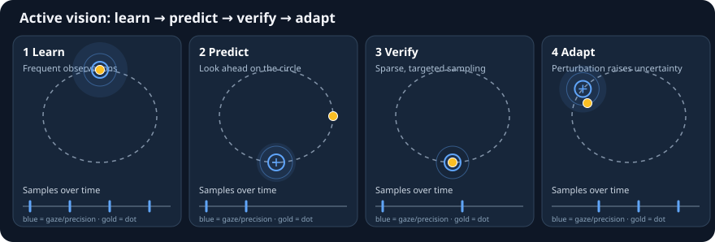

# Active vision through expected information gain

Status: research proposal — not an implementation specification.
Planning branch: `research/active-vision-eig`

## Literature and conceptual grounding for coding agents

**Read before implementing an EIG policy.** The experiment is motivated by active inference, not by generic saliency detection or reward-based tracking. These sources provide context; they are **not** a requirement to reproduce any particular published architecture.

1. **Friston, Adams, Perrinet & Breakspear (2012), [Perceptions as Hypotheses: Saccades as Experiments](https://doi.org/10.3389/fpsyg.2012.00151)** — **start here**. Directly relevant to the circular-dot thought experiment: eye movements as active tests of perceptual hypotheses, and selecting informative future observations. [Open full text](https://pmc.ncbi.nlm.nih.gov/articles/PMC3361132/).
2. **Parr, Pezzulo & Friston (2022), [Active Inference: The Free Energy Principle in Mind, Brain, and Behavior](https://direct.mit.edu/books/oa-monograph/5299/Active-InferenceThe-Free-Energy-Principle-in-Mind)** — open-access foundational treatment. See especially the overview, generative models, and chapters on designing active inference models and discrete/continuous time.
3. **Lanillos et al. (2021), [Active Inference in Robotics and Artificial Agents: Survey and Challenges](https://arxiv.org/abs/2112.01871)** — engineering-oriented survey of state estimation, action, planning, and learning under active inference; useful for implementation alternatives and limitations.
4. **Van de Maele et al. (2021), [Active Vision for Robot Manipulators Using the Free Energy Principle](https://doi.org/10.3389/fnbot.2021.642780)** — concrete active-viewpoint selection with learned generative models and expected free energy. Includes an instrumental reaching task; **our first experiment deliberately omits instrumental utility**.
5. **Millidge et al. (2021), [Whence the Expected Free Energy?](https://direct.mit.edu/neco/article/33/2/447/95645/Whence-the-Expected-Free-Energy)** — theoretical caution about deriving and interpreting expected free energy. Useful when deciding what objective we actually optimize.

### Interpretation guardrails

- The initial sensory-space mutual-information objective is **our deliberately simplified epistemic-only design choice**, not a claim that all active inference formulations operate only on sensory states.
- Expected information gain is an expectation over **possible future observations before observing them**, not the realized prediction error afterward.
- Confirming a hypothesis may be useful, but if every plausible hypothesis predicts the same observation, that observation has little expected information gain. Prefer measurements that discriminate uncertain alternatives.
- To allow sparse verification, define an observation budget or sampling cost, and include a **skip observation** action; otherwise an information-seeking agent may simply sample at every step.
- The dot generator's full trajectory and random seed are for the evaluator only. The agent must never use ground truth to choose its gaze.
- Agents should document which equations come from the literature and which approximations or modeling choices are specific to AudioViz.

## Motivation

AudioViz currently explores predictive coding over visual and audio inputs. We want to investigate whether a predictive model can **actively select what to observe** instead of passively consuming uniformly precise camera frames.

The biological inspiration is foveated vision: a limited sharp region of sensory input, with less precise peripheral observations and a model that predicts the broader scene. We want attention to be a *visible, measurable control variable*, not a hidden heuristic.

## Research question

Can a predictive-coding model actively choose **where and when to sample** to reduce uncertainty about **future sensory observations**? For the first experiment, the observable is a dot moving around a circle, optionally perturbed by Brownian offsets.

A core distinction to test: **large current prediction error is not equivalent to high expected information gain**. A surprising but irreducibly noisy region can have large error without being informative.

## Decisions from our discussion

**Settled for experiment 1**

- Optimize **epistemic value only** (expected information gain), without an instrumental task reward.
- Predict **future sensory states** (initially dot position / image observations), not a new semantic latent-state model.
- Attention controls **where and when to look**; continuously following the dot is *not* the objective.
- A predictable circular trajectory should allow the model to look ahead and verify its hypothesis intermittently.
- Prediction-error magnitude alone is **not** expected information gain. Prefer observations that distinguish competing predictions or reduce accumulated uncertainty.
- Start with a reproducible circular-dot stimulus, optional Brownian perturbations, and tests before integrating more complex camera scenes.

**Still open implementation/research choices**

- The probabilistic belief representation over future sensory states and how to calculate/approximate EIG with the existing predictive-coding architecture.
- The Gaussian precision-field width, baseline precision, total spatial/temporal sensing budget, and how to implement a no-observation action.
- Which existing modules can be reused, and the staged learning/frozen-weights schedule.
- How to quantify uncertainty calibration and separate reducible uncertainty from irreducible perturbation noise.

## Visual intuition

These are **schematic diagrams, not empirical results**. The agent must not receive the full-frame ground truth shown to evaluators.

### Circular-dot attention storyboard



**Legend:** gold = actual dot position; blue crosshair and halo = foveal center and spatial precision; dashed ellipse = nominal circular trajectory; blue ticks = observation events. These are illustrative snapshots, **not** a trained agent's measured behavior.

The visual target is an interactive or recorded sequence that shows (1) the dot and ground-truth trajectory, (2) the action-controlled **Gaussian precision heatmap** over the unmodified camera frame, (3) the predicted dot distribution or future image, and (4) a timeline of gaze actions, predicted information gain, and uncertainty. A future short video/GIF can be exported from the deterministic test stimulus and actual agent traces. Avoid implying that the schematic already demonstrates successful learning.

## Proposed computational graph (conceptual)

- Full camera frame `x_t` (available for experiment/evaluation).
- Attention/action parameters `a_t` (initially location and spatial extent; later anisotropic or multi-focus).
- **Spatial precision field** `Pi(r; a_t)`: a Gaussian centered at the action-selected gaze location, with low baseline precision in the periphery. This weights sensory prediction errors; no separate image blur/sampler is required in experiment 1. The field should be differentiable in gaze location if optimized by gradients.
- Predictive model (which may internally use existing hidden state) produces a future sensory prediction `x_hat_{t+1}`; **no new semantic latent model is required** for the first experiment.
- Inference updates to `z_t` from the *attended observation*, with a spatially varying observation precision or equivalent weighting.
- Attention policy chooses `a_t` based on predicted usefulness of the next observation.

The same action-dependent precision must be used consistently in the inference updates and in the observation likelihood assumed by EIG. The full frame may exist in the experimental harness, but the agent must not access its unweighted pixels through any other path.

## Gaussian spatial precision: attention mechanism

For image position `r=(u,v)` and gaze action `a_t=(a_u,a_v)`, use the initial parameterization

```math
\Pi(r;a_t)=\Pi_{\min}+\Pi_{\mathrm{peak}}\exp\left(-\frac{\|r-a_t\|^2}{2\sigma_f^2}\right).
```

`Pi_min` is peripheral baseline precision, `Pi_peak` the additional foveal precision, and `sigma_f` the fovea width. The precision-weighted sensory error is `epsilon(r)=Pi(r;a_t)*(x(r)-x_hat(r))`. In a Gaussian observation model, `Pi` is inverse observation variance; this makes gaze-dependent weighting a probabilistic choice of how much sensory evidence enters inference, rather than a visualization-only mask. The physical video frame itself need not be blurred. Very small peripheral precision should mean negligible evidential influence, and no other model path may bypass that restriction.

**Important contract:** A policy must evaluate candidate gaze actions using the *same* precision-dependent likelihood used for predictive coding. A pure scaling of a loss while still giving the model unrestricted access to the full image is not sufficient. Specify the observation covariance and normalization consistently; `Pi_min=0` represents an unobserved limit, requiring care with singular covariance. Fix or budget the precision mass/width so EIG cannot improve trivially by increasing precision everywhere.

## Information gain formulation (candidate, not yet committed)

For the first experiment, define:

- `X_{t+1}`: the uncertain **future sensory state** (initially dot position, optionally the full image).
- `D_t`: the history of attention-conditioned observations available to the agent, including past gaze actions.
- `a`: a candidate future gaze action, including location and whether to sample.
- `Y_a`: the observation that would be obtained if action `a` were taken.

The epistemic-only objective is the **expected information gain about the future sensory state**, evaluated before observing `Y_a`:

```math
IG(a) = I(X_{t+1};Y_a\mid D_t,a)
      = \mathbb{E}_{Y_a\sim p(\cdot\mid D_t,a)}
        \left[D_{KL}\left(
          p(X_{t+1}\mid Y_a,D_t,a)
          \;\|\;
          p(X_{t+1}\mid D_t,a)
        \right)\right].
```

The prior and posterior are distributions over the **same** random variable `X_{t+1}`. The predictive prior conditions on the candidate action for generality; if gaze affects only the measurement and not the underlying dot dynamics, then `p(X_{t+1}|D_t,a)=p(X_{t+1}|D_t)`.

The existing model may use an internal hidden state `z_t` to compute these sensory predictions, but `z_t` is **not the EIG target** in this initial experiment. Do not silently substitute information gain over hidden activations.

Choose gaze actions that maximize EIG subject to an explicit observation budget or sampling cost; without such a constraint, always sampling can be optimal. Open issue: if the current predictive-coding model only provides point estimates, a calibrated predictive distribution or a clearly identified and validated proxy is needed. **Do not equate realized prediction error with EIG.**

## Visualization and instrumentation

Show simultaneously:
1. Original full camera frame (ground truth, for development only).
2. Gaussian spatial precision field over the camera frame, with gaze center visible (not a separately blurred image).
3. Model's full-frame prediction.
4. Optionally, spatial prediction error and attention/precision maps.

Log attention position/shape, reconstruction quality by region, model uncertainty/proxy, and temporal stability. Avoid evaluation leakage from the original full frame into the inference path.

## Staged experiments

### Stage A — Gaussian precision field, no learned attention
Implement and test a deterministic spatial precision field with explicit contracts. Keep predictive model weights fixed initially. Verify that changing gaze location changes precision-weighted inference updates and the likelihood used for EIG, without introducing a separate blur pipeline.

### Stage B — optimize attention with a fixed model
Use a simple, explicitly named proxy objective first (e.g. predicted reconstruction improvement under an observation budget), while separately testing whether it tracks actual information gain on synthetic controlled data. Compare against fixed-center, random, and prediction-error-greedy attention.

### Stage C — probabilistic/EIG attention
Introduce an uncertainty representation appropriate to the existing model, derive an operational EIG estimator, and validate it on a toy environment with known latent variables and distractor noise before moving to live camera scenes.

### Stage D — joint learning and dynamics
Investigate attention-model co-adaptation, temporal predictive memory, movement penalties, and whether policies revisit informative regions as beliefs change. This is exploratory and must not be conflated with Stage A.

## Workstream boundaries for CLI agents

- **WS1: architecture audit.** Read current repo; identify camera source, predictive coding interfaces, inference update, rendering and tests. Return a proposed integration seam, not code changes.
- **WS2: spatial precision field.** Implement Stage A in a small independently testable module; include numerical tests for Gaussian center/width, positivity, boundary behavior, gradient if required, and consistent precision use in inference and observation likelihood.
- **WS3: visualization.** Add side-by-side observation/prediction and visible attention map with minimal coupling to the model.
- **WS4: experimental harness.** Add reproducible synthetic scenarios, metrics and baseline attention policies.
- **WS5: EIG derivation and estimator.** Research/derive probabilistic formulation grounded in the actual model representation; no implementation until approved.

Each workstream should be a separate issue or implementation branch, with tests and a small PR. No coding agent should interpret this research document as permission to implement all stages.

## Outstanding questions (not already decided)

- Which belief family can express uncertainty about **future sensory observations** with the existing model?
- What tractable estimator approximates sensory-space EIG, and how will it be validated against a controlled probabilistic toy model?
- What Gaussian width, baseline/peak precision, and spatial sensing budget should the first implementation use?
- How should observation timing be represented (including the option **not to sample**), and what cost/budget prevents always observing?
- What should be held fixed versus learned at each stage?
- How do we distinguish reducible uncertainty from unpredictable Brownian perturbations?

The *objective* (epistemic value), *initial uncertainty target* (future sensory state), and *behavioral goal* (predictive, intermittent verification) are already decided. Do not reopen them without new evidence.

## Engineering principles

Minimal, modular, efficient, parsimonious and maintainable. Clear interfaces, reproducible configs, independent unit tests, and incremental experiments. Keep research claims separate from empirical observations and implementation choices.

## First test-driven experiment — circular moving dot

This is the **first implementation target**. Before writing new components, audit the existing repository for synthetic video sources, moving-dot generators, camera-input adapters, predictive dynamics, and test utilities; reuse existing capabilities where practical. Do not assume these features are absent or already present without checking.

### Reproducible stimulus

- Generate a deterministic, seed-controlled sequence of frames showing a single dot moving along a circular trajectory, with configurable center, radius, angular velocity, phase, dot size, frame rate, and duration.
- Add an optional stochastic perturbation: a Brownian/random-walk offset around the nominal circular path. Define its increments and scale explicitly; use a fixed seed in tests. Include a zero-noise control and multiple noise levels.
- Make the sequence available through the existing synthetic-frame interface if possible; optionally export a video file for visual inspection. Tests should consume raw frames and known ground-truth positions directly rather than relying on video codec decoding.
- Keep the generator independent of attention and inference, so ground truth cannot leak into the agent's observation or policy.

### Behavioral objective

An agent sees only its attention-conditioned observations and predicts where the dot will appear. It selects *where and when* to look to reduce uncertainty about the sensory trajectory. The goal is **epistemic value**, not tracking error or reward for keeping the dot centered. A confident circular-motion hypothesis should permit intermittent checks, while uncertain dynamics or perturbations should motivate renewed sampling. Treat this as a hypothesis to test, not guaranteed behavior.

For the simplest sensory-space formulation, the uncertain quantity may be the dot's future sensory position or the future image, rather than a new learned semantic latent state. The precise belief representation and EIG estimator remain design questions; do not label a prediction-error heuristic as EIG.

### Test-first acceptance criteria

1. **Stimulus correctness:** with zero noise, generated positions match the analytic circle within tolerance; frames and positions are reproducible for the same seed/configuration.
2. **Perturbation correctness:** zero perturbation yields the exact baseline; nonzero seeded Brownian increments follow the documented process; trajectories stay within the defined image-handling policy (e.g., clipping or allowing off-frame positions).
3. **Observation isolation:** the agent receives only the attention-conditioned frame; full-frame truth and exact dot coordinates are used only by the harness for evaluation.
4. **Prediction test:** on an analytically known circular trajectory, compare predicted future positions against ground truth over multiple horizons, including without a new observation.
5. **Attention baselines:** compare fixed fovea, random sampling, and error-greedy sampling against the proposed epistemic policy under the same observation budget.
6. **Hypothesis tests:** measure whether the policy samples less often when the trajectory becomes predictable and increases sampling when dynamics become uncertain or change. Do not hard-code these outcomes into tests; evaluate them empirically.
7. **Metrics:** log sampling frequency, selected gaze locations, uncertainty calibration or declared proxy, prediction error, and robustness across noise levels and random seeds.

### Agent handoff

Start with a repository audit and a minimal test plan. Implement the deterministic synthetic stimulus and its tests first, then add stochastic perturbations and tests. Only then integrate Gaussian precision-weighted sensory inference and an explicitly defined information-seeking policy. Keep the generator, observation operator, predictive model, and policy independently testable. Do not alter the production camera pipeline unnecessarily.
