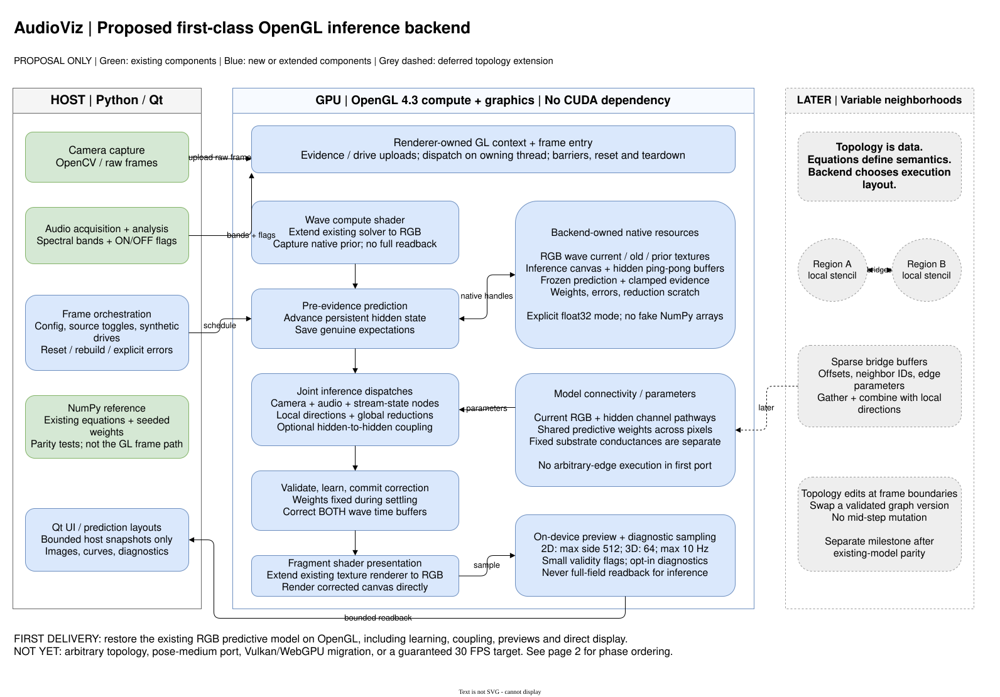
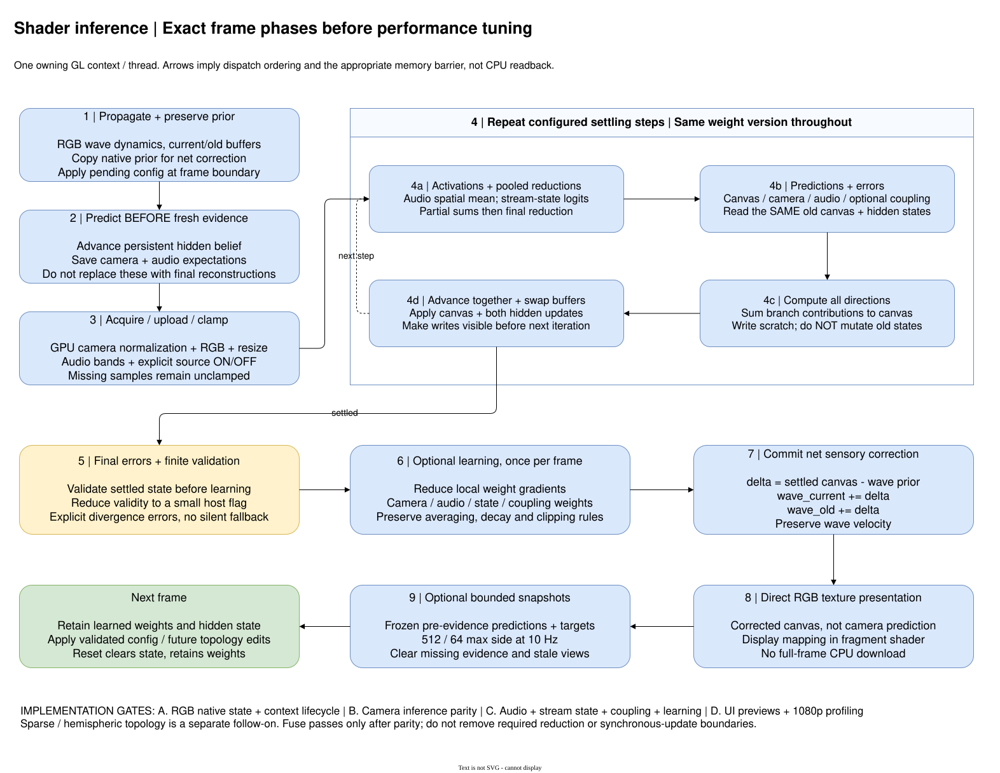
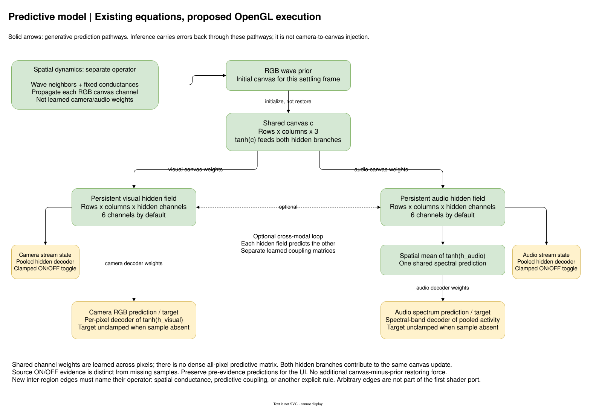

# OpenGL predictive inference: architecture and implementation

**Status: existing-model shader port implemented.** The diagrams preserve the
original design proposal; the implementation now covers RGB waves, native prior
and correction, camera/audio/state/coupling inference, optional learning,
bounded previews, plots and direct RGB/grayscale presentation.

The goal is to restore OpenGL as a first-class backend for the **existing**
predictive model, not just wave propagation. No CUDA dependency is required.
Arbitrary neighborhoods remain a follow-on; this port must not lock the model
to texture coordinates as its only possible connectivity representation.

## Visual plan

Open [the editable draw.io file](shader-inference-architecture.drawio) in the
desktop draw.io application. It has three pages:

1. **System architecture:** host/device boundaries, native resources, current
   components to extend, and a clearly deferred variable-topology extension.
2. **Frame phases and milestones:** synchronous settling, reductions, learning,
   correction, presentation, and implementation gates.
3. **Predictive model graph:** RGB canvas, both hidden fields, sensory decoders,
   pooled audio, stream-state evidence, and optional hidden coupling.







The source is uncompressed XML, following the existing
`ripple-necessary-conditions.drawio` convention. draw.io is already installed
locally; an additional skill or cloud diagramming service is not needed.
Excalidraw would also work, but draw.io suits the component and phase boundaries
and already has precedent in this repository.

## Implementation and operation

`utils/opengl_compute.py` owns explicit float32 native arrays and hierarchical
reductions. `readouts/opengl_predictive.py` implements shader phase scheduling
and readout facades; the existing orchestrator selects it only for OpenGL.
No CUDA-specific operations or new dependencies are introduced.

Set renderer backend to `"opengl"` and
`transforms.prediction_error.inference.dtype` to `"float32"`. The startup
configuration now specifies float32 explicitly; array readout API defaults remain
float64. The backend rejects unsupported precision and missing GL capabilities.
The existing camera/audio source controls, inference/learning controls, optional
hidden loop, plots and all three prediction layouts are available.

The first rendered native-1080p baseline on the RTX 3060 is 117 ms/frame without
learning/coupling and 208 ms/frame with both, at eight steps, using synthetic
sensors. See README for measurement conditions and benchmark commands. This
delivery restores correctness and integration; further shader fusion and
reduction optimization are still needed for realtime native 1080p.

Real-GL parity tests cover repeated frames, missing samples, source state,
learning with clipping/decay, coupling, diagnostics, finite errors, RGB wave
correction, camera preprocessing and automatic levels. The same numerical tests
run on Mesa software OpenGL. Window-system tests cover direct rendering,
existing prediction layouts, controls, reset and resource cleanup.

```bash
QT_QPA_PLATFORM=xcb .venv/bin/python -m pytest -q \
  tests/readouts/test_opengl_predictive.py \
  tests/visualization/test_shader_ripple_wave_visualizer.py
```

The phase contract is unchanged. Local kernels fuse compatible pointwise work;
global pooling/gradient reductions remain explicit, and native prior/correction
never require full-field downloads. Automatic display percentiles use exact
positive-float radix selection with small histogram readbacks. Camera uploads
use float32 raw-value storage, then shader normalization/RGB/resize/gain.

## Pre-port integration gaps (design record)

| Surface | Current behavior | Required change |
| --- | --- | --- |
| `physics/opengl_wave_propagator.py` | OpenGL 4.3, scalar `r32f` textures, four-neighbor wave stencil, ping-pong state | RGB wave state, native prior and correction access, explicit resource cleanup |
| `engine.py` | Rejects multichannel OpenGL; `_capture_prior` downloads; sensory correction and previews reject shaders | Native state handles and RGB prior/correction/preview operations |
| `sources/orchestrator.py` | Constructs array readouts; blocks shader audio, joint inference and cross-modal coupling | Select a shader implementation without routing state through NumPy |
| `readouts/predictive_coding.py` | NumPy/CuPy inference, persistent hidden states, shared weights, optional hidden coupling and stream-state evidence | Equivalent shader phases using the same model/configuration |
| `readouts/audio.py` | Spatially pooled audio decoder and pooled learning gradients | Device-side multipass reductions, not a separate local audio target per pixel |
| `visualization/ripple_renderers.py` | Existing direct OpenGL field rendering is scalar and signed-color mapped | RGB presentation and display controls on native textures |
| `visualization/ripple_wave_visualizer.py` | Blocks shader camera, plots and prediction popup; frame path uses array inference | Dispatch under the renderer-owned context; bounded shader snapshots for existing UI |

The pre-port OpenGL engine reported NumPy as its array backend. Passing an `xp`
module through the existing readouts cannot make these arrays into OpenGL state.
The shader path needs backend-owned resource operations, not NumPy-shaped
placeholders with implicit full-field readback.

## Proposed resource and execution boundary

Keep Python/Qt responsible for source acquisition, configuration, scheduling and
UI. Keep wave state, hidden state, weights, errors, inference and learning on
OpenGL. Existing NumPy and CuPy behavior remains available and unchanged.

Use one renderer-owned GL context on its owning thread for dispatch and
presentation. Offscreen validation uses the same resource/phase implementation
with an explicitly owned offscreen context. Do not create an unrelated context
for inference and assume it can see the renderer's resources.
Allocate shader resources lazily once that context is current: the visualizer
currently constructs the engine and orchestrator before constructing its renderer.
Check GL version, compute/SSBO support and resource limits before enabling the path.

Start with RGB canvas textures, for example `rgba32f` with an unused fourth lane,
and float32 shader-storage buffers for configurable hidden channels, weights and
reduction scratch. Keep wave current/old/prior distinct from inference scratch.
Specific packing and workgroup sizes belong to the backend and may change after
profiling; they do not define graph semantics.

Reuse configuration, deterministic initialization and observable readout behavior
from the array implementation. Introduce only the native operations needed by
the existing engine/orchestrator/readout boundary. GL handles are not arrays;
host snapshots must be explicit. This is not a general graph compiler.

**Precision:** the first shader port should require explicitly selected float32
inference. Preserve the existing float64 defaults for array readouts. Reject an
unsupported shader precision clearly rather than silently downgrading it.
Portable float64 shaders are outside this first delivery.

## Semantics that must survive the port

- Propagate, advance hidden prediction and save genuine camera/audio expectations
  **before** consuming fresh sensory evidence. A final reconstruction is not the
  prediction displayed by the popup.
- All branch directions in a settling iteration read the same old canvas and
  hidden states. Use scratch or ping-pong state; advance only after every
  direction is available. Weights remain fixed throughout settling.
- Pool hidden activations for audio predictions and stream-state logits. Reduce
  partial sums in separate dispatches where necessary. A workgroup barrier does
  not synchronize the whole image.
- Preserve camera/audio source ON/OFF evidence separately from sample
  availability. Missing image/spectrum samples leave those targets unclamped,
  not zero-clamped; hidden inference and appropriate learning still continue.
- Preserve optional hidden coupling, final-state gradient averaging, weight
  decay and gradient/weight clipping, including the existing audio broadcasting
  and normalization conventions.
- Validate settled state before learning. Download a reduced validity flag, not
  full arrays; keep explicit divergence errors. GPU-resident computation does
  not mean that every host synchronization can be eliminated.
- Commit `delta = settled_canvas - wave_prior` to **both** wave time buffers.
  Do not introduce a prior-restoring force or change wave velocity through
  one-sided correction.
- Keep RGB, grayscale, automatic/manual display levels and source controls
  consistent. Direct texture rendering is the normal presentation path; host
  image readback is not.
- Preserve aspect-correct, immutable UI snapshots: maximum side 512 for 2D,
  64 for 3D, at most 10 Hz. Collect expensive diagnostics only when requested.
  Clear stale evidence/views on missing samples, hide, minimize, switch or reset.
- Reset clears wave/hidden/error state and previews, retaining learned weights.
  Rebuilding resolution, hidden channels or precision must recreate resources
  safely. Context destruction must release resources while the owner is valid.

Use the correct OpenGL memory barrier for the next access (SSBO, image or texture
sampling); distinguish these GPU visibility barriers from a CPU-completion fence.
Do not use `glFinish` after every pass. Capability checks and shader compiler/linker
errors must be explicit, with no silent fallback to CPU inference.

## Implementation gates

| Gate | Deliverable | Acceptance before moving on |
| --- | --- | --- |
| A: native RGB state | Extend GL wave propagation, native prior, correction, renderer/context lifetime | CPU parity on small RGB grids, supported boundaries, both-buffer correction; normal frame path does not download the field |
| B: camera inference | Prediction, local errors, simultaneous canvas/hidden updates, clamped evidence | Float32 NumPy parity at each phase and across repeated frames; frozen weights; genuine pre-evidence predictions |
| C: full existing model | Audio pooling, stream-state nodes, missing samples, optional hidden coupling, learning and validation | Joint and learning parity including clipping/decay, all source-state combinations, divergence errors and reset/rebuild behavior |
| D: presentation + measurement | RGB/grayscale/levels, existing popup layouts and plots through bounded snapshots | Lifecycle and transfer-bound checks; GPU timings after warmup; native 1080p compute and rendered measurements, with learning/coupling on and off |

Add OpenGL integration coverage to the existing engine/readout/UI suites and
extend `scripts/benchmark_predictive_inference.py` to select OpenGL explicitly.
CPU-only environments must still import and run without a GL context or CuPy.
GL tests should identify missing hardware/context support explicitly rather than
counting an untested CPU fallback as shader parity.

Compare deterministic float32 runs with appropriate measured tolerances;
reductions need not be bitwise identical. Report frame-time distribution and
capture-to-display latency separately from throughput. Do not claim 30 FPS from
an inference-only or shader-dispatch-only measurement.

Implement readable phase-correct shaders first, then fuse compatible local
passes and tune workgroups after GPU profiling. Global reductions and update
ordering constrain fusion; looping independently through all inference steps
inside each pixel is not equivalent to the current model.

## Variable topology: preserve the boundary, defer the implementation

**Topology is data; update semantics belong to the model; execution layout
belongs to the backend.**

The first port reproduces the current stencil and channel pathways. A later
extension can retain an efficient local stencil and add sparse gather passes
using node offsets, neighbor IDs and edge parameters. This accommodates two
regions with arbitrary bridges without recompiling for every connection edit.
Combine local and sparse contributions before the same synchronous advance.

Keep fixed substrate conductances separate from learned predictive weights.
Before implementing new edges, define which equation they participate in:
spatial dynamics, predictive coupling, or another explicit operator. Connectivity
alone does not specify the update rule.

Validate and apply graph versions at frame boundaries. Storage may need
reallocation when connectivity changes; shader portability does not make sparse
execution or graph edits free. Dynamic topology, pose-medium coupling and a
Vulkan/WebGPU migration are not prerequisites for restoring OpenGL inference.

## Local diagram export

Run from the repository root; these commands use the installed desktop exporter,
not a remote service:

```bash
xvfb-run -a drawio --disable-update --export --format svg --page-index 1 \
  --embed-svg-fonts false --theme light --border 20 \
  --output docs/shader-inference-system.svg docs/shader-inference-architecture.drawio
xvfb-run -a drawio --disable-update --export --format svg --page-index 2 \
  --embed-svg-fonts false --theme light --border 20 \
  --output docs/shader-inference-phases.svg docs/shader-inference-architecture.drawio
xvfb-run -a drawio --disable-update --export --format svg --page-index 3 \
  --embed-svg-fonts false --theme light --border 20 \
  --output docs/shader-inference-model.svg docs/shader-inference-architecture.drawio
```

The diagram remains editable alongside the implementation. No vendor-specific
tooling is required to run or extend the OpenGL backend.
